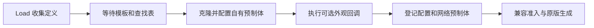

# 当前设计

本文说明当前源码中的模块职责、接口与行为。当前构建/待办见 [TODO](../TODO.md)，使用方式见 [README](../README.md)，版本变化见 [CHANGELOG](../CHANGELOG.md)，原生研究与实际验收证据见 [DEVELOPMENT](../DEVELOPMENT.md)。本文的同步路径与流程说明不代替真实游戏验收。

## 术语与模块

| 术语 | 含义 |
| --- | --- |
| 原版 | Invokyr 游戏本体 |
| 雕像类型 | 具有稳定 key、配置 ID、assetId 和效果定义的一种内容 |
| 雕像实例 | 场景中某只物品，以 netId 标识；ScoreTool 属于 Item |
| 类型注册 | 创建配置、查找表条目和网络预制体；EntityManager.RegisterIdol 只登记已有实体 |
| 小局 | 确认骰子事件后探索变化地图、带回雕像的一轮 |
| 大局 | 整个房间/跑团会话 |
| 生成批次 | 一次实际原版生成调用；小局与生成批次不一定一一对应 |
| 入池 | 加入筛选前候选集合；不等于被抽中或已经生成 |

| 源码 | 职责 |
| --- | --- |
| [CalypsoExpansionSetPlugin.cs](../CalypsoExpansionSetPlugin.cs) | Load 登记内置定义、协调维护与卸载、服务器调试生成 |
| [IdolDefinition.cs](../IdolDefinition.cs) | 注册 API、定义字段、执行端与 HeldIdolEffect 生命周期 |
| [IdolRegistry.cs](../IdolRegistry.cs) | 克隆/查找/网络登记、兼容清单、视觉资源所有权 |
| [IdolSpawnIntegration.cs](../IdolSpawnIntegration.cs) | 当前 ItemSet 的批次副本、自然候选接入与结果统计 |
| [IdolEffectRuntime.cs](../IdolEffectRuntime.cs) | 识别当前持有物，按类型/执行端启动、更新和停止效果 |
| [JumpingIdolSync.cs](../JumpingIdolSync.cs) | 全类型兼容准入与服务器实例/调试来源记录；保留历史文件名 |
| [Idols/JumpingIdol.cs](../Idols/JumpingIdol.cs) | 原力度连续跳跃 |
| [Idols/SpringIdol.cs](../Idols/SpringIdol.cs) | 弹簧编排、原生单次力度补丁与可选测量 |
| [Visuals/StickyNoteVisuals.cs](../Visuals/StickyNoteVisuals.cs) | 便签网格、纹理、材质与视觉诊断资源 |
| [IdolDebugTools.cs](../IdolDebugTools.cs)、[IdolDebugTeleport.cs](../IdolDebugTeleport.cs) | F8 命令窗口、输入恢复与服务器调试传送 |
| [Testing/TestRoomLaunch.cs](../Testing/TestRoomLaunch.cs)、[Testing/TestRoomScene.cs](../Testing/TestRoomScene.cs) | 专用单人入口与陈列房；其他 Testing 文件负责布局、资源和模式补丁 |

## 类型注册

`CalypsoExpansionSetApi.Register(IdolDefinition)` 在插件 Load 阶段收集定义。外部插件引用本程序集并声明对 `calypso.invokyr.expansionset` 的 BepInDependency；首次运行期初始化后定义锁定。

定义必须有 key、显示名、非零且独立的 ulong 配置 ID / uint assetId、有效模板、效果工厂及执行端。重复 key/配置 ID/assetId、非法版本/权重会被拒绝。

| 可选字段 | 当前含义 |
| --- | --- |
| ContentVersion | 默认 1；手工维护玩法、配置和外观契约版本 |
| PoolTemplateId | 自然池匹配标记；为空时使用 TemplateId，必须是有效雕像配置 |
| InitialWeight | 初始相对权重，未指定使用原版默认值；不是百分比 |
| ConfigureData | 修改自有配置副本，不能改稳定身份 |
| ConfigurePrefab | 修改自有预制体，保留必要物品/网络结构 |
| CreateVisuals | 在自有预制体创建附件并返回 IDisposable；构造抛错前自行回滚 |

资源就绪后，注册器克隆 SOScoreTool 与预制体。预制体在非活跃父节点下创建，避免 Awake 提前看到模板身份；随后连接自有 gameplayElementData、清除 sceneId、设置 assetId、运行配置/视觉回调，最后接入 scoreTools、_scoreById 和 Mirror 预制体表。

创建失败清理本次配置、预制体和视觉资源；整个注册/运行失败时不宣称 ready，并阻止新内容准入。场景重建预制体表或配置查找表时重新登记保持幂等，不覆盖冲突条目。活跃会话不热卸载。

兼容清单按配置 ID 排序，包含 key、配置 ID、assetId、TemplateId、实际 PoolTemplateId、ContentVersion 和执行端；不自动散列委托或资源文件。改变契约时必须提升对应内容版本。

## 内置雕像

身份参数的权威来源是两种源码的 Definition。当前定义如下：

| 名称 | key | 配置 ID | assetId | ContentVersion | 执行端 |
| --- | --- | --- | --- | --- | --- |
| 跳跃雕像 | jumping | 0x4D49000000000001 | 0x4D490001 | 8 | OwnerNativeGameplay |
| 弹簧雕像 | spring | 0x4D49000000000002 | 0x4D490002 | 1 | OwnerNativeGameplay |

两种均使用 Score 配置/外观模板 `7331884207844971565`，以 Slippery `13601636613369722279` 匹配自然池。基础属性继承模板，均未指定自定义初始权重。

跳跃雕像在落地、没有原版待处理跳跃且未处于跳跃状态时，继续调用原版跳跃输入，保持原力度；不另加落地等待，也不在拿起时清空体力。

弹簧采用固定编排：四次小跳后正常跳，再五次小跳后稍高跳，循环执行。首次等待 0.15 秒，成功起跳后所有节拍落地等待 1 秒；小跳目标约半米，力度系数 0.58，并按原版 JumpForceMultiplier 把起跳速度上限限制为 3.6；正常/稍高节拍系数为 1 / 1.12。实际高度依赖原版重力、地形和角色条件，测得高度见对应版本验收记录。

弹簧先通过原版输入排队，再按物品、持有者、角色控制权、请求时间戳及超时核对待处理请求。在匹配的 HandleJumpRequest 单次调用内临时调整该角色 jumpForce，Finalizer 恢复自己的写入；不持久改共享配置、刚体速度或重力倍率。若其他 MOD 已写入不同力度，不覆盖其值。原生调用异常后停用本次效果直到释放。

两种均不主动写体力，继续沿用原版起跳体力处理。菜单/控制禁用时不新增动作；空中和既有请求优先完成。手动跳跃不强制变成弹簧节拍，可推迟自动节奏。放下/转交/失效时停止效果，但不截断已经由原版接受的跳跃。

0.2.12 曾把弹簧保存在 jumping 身份下；拆分后 jumping 恢复跳跃，弹簧另用 spring，调试命令相应改变。没有自动迁移已有存档类型；升级变化见 [CHANGELOG](../CHANGELOG.md)，存档恢复仍待验收。

## 自然生成

服务端在原版 SrvSpawnItemsForData 开始前复制当前 ItemSet，再按每个定义的 `PoolTemplateId ?? TemplateId` 将自有配置加入对应雕像候选 entry。当前快照中两种匹配含 Slippery 的 9 个池；Score 本身主要位于答题池，外观模板不等于合适的普通地图匹配标记。

批次副本保留原版候选顺序、bonus、生成数量与难度字段，重复接入每种只加入一次。缺失注册/兼容或 NaturalSpawning=false 时排除自有候选；客户端不修改自然池。完成或异常后只释放批次副本。

已研究的原版资源/行为：

- defaultIdolWeight=100，idolWeightDivisor=2；选中类型后当前权重减半。自定义初始权重只在首次接入/原版重置时应用，不每小局重置。
- maxSpawnsPerIdolType 的资源默认为 2，计数属于该次生成调用；原版事件可忽略上限。多个独立调用分别统计，不把它扩大为整个小局或大局的总上限。
- 仍由原版处理 seed、难度、事件、biome/tag、掉落点、房间、皮肤与价值；加入候选不保证抽中。保留地图/恢复事件可能不调用新生成。

日志用事件 ID、seed、批次号关联定义、候选与结果：

| 日志 | 含义 |
| --- | --- |
| [Definition] | 收集定义 |
| [Register] / [Registry] ready | 自有资源创建 / 注册就绪 |
| [Pool] | 本批次原版筛选前的 MOD 候选 |
| [Natural spawn] / [Batch result] | 实际实例 / 批次完成或失败结果 |
| [Debug spawn] | 明确操作产生的手动实例，独立记录 |

## 执行端与同步

| 执行端 | 决策与执行 | 网络和恢复要求 |
| --- | --- | --- |
| LocalPresentation | 当前持有者客户端修改自己的画面/声音/UI | 持有身份沿用权威状态；各退出路径恢复自身表现 |
| OwnerNativeGameplay | 拥有角色控制权的客户端调用原版动作 | 运动/动画继续走已确认的原版同步；服务端和观察者不重复执行 |
| ServerGameplay | 服务端验证并修改世界/跨玩家状态 | 效果自己调用实际网络 setter/RPC；自有稳定状态另设计快照 |

执行器通过原版配置 ID 识别类型，以 ItemOwner 与 InventoryNew.InHand 判断实际持有物；本地动作还要求本机角色有移动控制权、连接 Ready、清单匹配且游戏控制可用。EntityManager.Me 来自 UserInstance.Me.playerEntity，不用 PlayerEntity.isLocalPlayer 再拒绝可移动房主。

兼容协议由 JumpingIdolSync 统一处理，消息 ID=0x4D49、协议版本=3。客户端在 Ready 前发送清单握手，服务端暂缓 NetworkServer.SetClientReady，匹配后再恢复原版 Ready；缺失 MOD 超过 30 秒或版本/清单不匹配拒绝连接。连接 ID 复用核对实际连接身份，不继承旧兼容状态。

雕像生成、配置、物品持有状态及实例晚加入恢复使用原版网络 prefab/SyncVar；没有重复的自有实例 marker 快照。跳跃/弹簧只有持有者所属端编排动作，观察者依靠原版运动/动画同步看到结果；弹簧力度不另作自有网络字段广播。原版路径接入、托管模拟与真实双端验收是不同证据，当前边界查看 [TODO](../TODO.md)。

声明 ServerGameplay 不会自动同步字段。新增价值状态应使用 Network_currentValue 等实际原版入口；新增稳定玩法状态、随机结果、可重放事件或存档契约需要独立设计与验证。

## 便签资源与生命周期

当前两种内置雕像都显式配置 `CreateVisuals = prefab => StickyNoteVisuals.Create(prefab, "jumping")`。类型 key（jumping/spring）与图案 key 分开，暂用同一图案，但每种类型创建独立 Mesh、Material、Texture；同类型实例使用其预制体资源。

便签从 DLL 内嵌的 note.mesh.json 和按图案 key 选择的预合成 RGBA mip 链创建视觉对象，挂在自有 Score 预制体 `Dice/SM_IdoleBody/SM_IdolHead` 下。随后原版生成复制带附件的完整预制体；不在场景生成后扫描雕像补挂，不修改原版同模型雕像，也不添加拾取/物理/网络组件。

注册器持有返回的 IDisposable，后续创建失败或正常卸载清理。便签工厂在返回前抛错时自己回滚。指定图案缺失会注册失败，不自动降级为空白。外部注册 API 的视觉回调可选，不自动导入 FBX 或加载其他模型。

原始 bianqian.fbx 已导出为头部局部坐标网格；note.mesh.json 决定形状，paper.rgba 是底色，Baked/jumping.rgba 是带图案的运行贴图。完整资源来源、UV、导入及诊断方法见 [便签说明](../Assets/StickyNote/README.md)。

## 调试与测试房

调试 UI 是 MOD 自有 F8 窗口，不依赖场景中缺失的原版控制台。命令和配置的使用说明见 [README](../README.md)。

- DebugMode 默认 false，统一控制测试窗口、调试操作与诊断日志；关闭 F8 不改变配置开关。关闭 DebugMode 清理诊断活动，不影响雕像玩法，必要状态与异常日志保留。
- list / spawn <key> 从注册清单生成；快捷按钮只显示前三种，其他类型用命令。每种同时最多一只手动实例，出售/销毁后释放配额；自然实例不占配额。
- 直接 SrvSpawnToolOnGround 不包含自然批次的皮肤/价值初始化。调试生成读取 idolsScoreData，未指定皮肤时选 Bronze，用原版 Skin / CurrentValue 同步 setter 初始化；不要调用下节的越界包装。
- teleport 按 netId 循环查找存活自然/调试 MOD 雕像，验证地面与角色空间后调用原版 TargetTeleport；关闭窗口恢复控制后下一帧执行，角色/连接变化或超时取消。

专用测试房要求 --ces-test-room、DebugMode=true、TestRoomEnabled=true 同时满足，普通启动不会自动建房。它沿原版 KCP 流程开本机单人会话，跳过 Logo，在初始房门外建立陈列房、打开连接门并放置玩家；只允许本地连接，阻止事件/怪物生成和存档写入，不自动补刷展品。

后部摆放 20 种非怪物原版雕像（含两种特殊拼图；排除怪物 WanderingDice），两排各 10 个。中部按稳定 key 自动陈列每种 MOD 一只并计入各自调试限额。基座只读复用 SM_SocleStatue 网格/M_SocleStatue 材质，自建静态承托碰撞，不复制来源房间脚本。

布局由 [TestRoomLayout.cs](../Testing/TestRoomLayout.cs) 控制：横距 2.2 米、排距 3.2 米、每排最多 10 个，不满行居中，MOD 增加时延长房间；每区最多 128 种，超出时报错。当前两种布局已做源码检查，实际同时陈列尚待游戏验收。顶部只过滤 UI/lobby/waitPlayerBeforeStart 对应键/译文，保留其他 HUD。

## Interop 禁用项

这些条目来自已记录的原生/游戏问题；更换游戏或 interop 后应复核，不从托管模拟通过推断封送正确。

| 路径 | 已确认问题及当前处理 |
| --- | --- |
| TryGetIdolSkinData(out FIdolScoreMaterialData) | 包装只分配 8 字节，原生值为 24 字节，存在越界；禁止调用，改读 idolsScoreData 装箱条目 |
| ImageConversion.LoadImage | 本机包装走缺失的 ReadOnlySpan 方法；便签使用已核对的 LoadRawTextureData(IntPtr,int) 上传完整 RGBA mip 链 |
| GUI.SetNextControlName / 自动聚焦流程 | 本机 SetNextControlName 触发 ReadOnlySpan.GetPinnableReference 缺失异常；窗口避免控件命名/FocusControl 自动聚焦，异常时关闭 |

详细发现和替代路径验证保留在 [DEVELOPMENT](../DEVELOPMENT.md) 的调试闪退、便签与测试窗口记录中。原生缓存位置/二进制哈希保存在本机 `.local/ENVIRONMENT.md`（若存在）；反汇编前核对实际 GameAssembly，不直接使用旧 RVA。原版资源快照见 [idol-defaults.json](../research/idol-defaults.json)、[itemset-defaults.json](../research/itemset-defaults.json)、[test-room-pedestal.json](../research/test-room-pedestal.json)。
