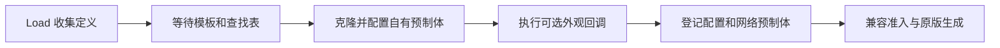

# 当前设计

本文说明当前源码中的模块职责、接口与行为。当前构建/待办见 [TODO](../TODO.md)，使用方式见 [README](../README.md)，版本变化见 [CHANGELOG](../CHANGELOG.md)，原生研究与实际验收证据见 [DEVELOPMENT](../DEVELOPMENT.md)。本文的同步路径与流程说明不代替真实游戏验收。

## 术语与模块

| 术语 | 含义 |
| --- | --- |
| 原版 | Invokyr 游戏本体 |
| 雕像类型 | 具有稳定 key、配置 ID、assetId 和效果定义的一种内容 |
| 雕像实例 | 场景中某只物品，以 netId 标识；ScoreTool 属于 Item |
| 类型注册 | 创建配置、查找表条目和网络预制体；EntityManager.RegisterIdol 只登记已有实体 |
| 小局 | 确认骰子事件后探索变化地图、带回雕像的一轮 |
| 大局 | 整个房间/跑团会话 |
| 生成批次 | 一次实际原版生成调用；小局与生成批次不一定一一对应 |
| 入池 | 加入筛选前候选集合；不等于被抽中或已经生成 |

| 源码 | 职责 |
| --- | --- |
| [CalypsoExpansionSetPlugin.cs](../CalypsoExpansionSetPlugin.cs) | Load 登记内置定义、协调维护与卸载、服务器调试生成 |
| [IdolDefinition.cs](../IdolDefinition.cs) | 注册 API、定义字段、执行端与 HeldIdolEffect 生命周期 |
| [IdolRegistry.cs](../IdolRegistry.cs) | 克隆/查找/网络登记、兼容清单、视觉资源所有权 |
| [IdolSpawnIntegration.cs](../IdolSpawnIntegration.cs) | 当前 ItemSet 的批次副本、自然候选接入与结果统计 |
| [IdolEffectRuntime.cs](../IdolEffectRuntime.cs) | 识别当前持有物，按类型/执行端启动、更新和停止效果 |
| [ExpansionSetSync.cs](../ExpansionSetSync.cs) | 全类型兼容准入与服务器实例/调试来源记录 |
| [ExpansionSetDriver.cs](../ExpansionSetDriver.cs) | 插件动态创建的 Unity 更新组件，驱动 Tick 和调试窗口绘制 |
| [Idols/JumpingIdol.cs](../Idols/JumpingIdol.cs) | 原力度连续跳跃、自动请求归属与成功起跳音效 |
| [Idols/SpringIdol.cs](../Idols/SpringIdol.cs) | 暂停注册的旧弹簧编排，保留源码和身份 |
| [Idols/FovIdol.cs](../Idols/FovIdol.cs) | 近景持有者的本地 FOV 缩放过渡与恢复 |
| [Idols/VoiceIdol.cs](../Idols/VoiceIdol.cs)、[Idols/VoiceInputGate.cs](../Idols/VoiceInputGate.cs)、[Visuals/VoiceEyeGlow.cs](../Visuals/VoiceEyeGlow.cs) | 声控持有者的方向输入替换、麦克风判定及全员红蓝眼睛 |
| [Idols/UpsideDownIdol.cs](../Idols/UpsideDownIdol.cs)、[Idols/DelayedMoveIdol.cs](../Idols/DelayedMoveIdol.cs)、[Idols/ExtremeSpeedIdol.cs](../Idols/ExtremeSpeedIdol.cs) | 渲染期间倒立、方向输入延迟与原生速度计算 |
| [Idols/DuckStepIdol.cs](../Idols/DuckStepIdol.cs)、[Audio/HeldIdolAudio.cs](../Audio/HeldIdolAudio.cs)、[Audio/IdolHearing.cs](../Audio/IdolHearing.cs) | 原版脚步触发、共享一次性音效协议、服务器听觉和 FMOD 资源 |
| [Idols/RelayIdol.cs](../Idols/RelayIdol.cs)、[Idols/RelayFatigue.cs](../Idols/RelayFatigue.cs)、[Idols/RelayIdolRuntime.cs](../Idols/RelayIdolRuntime.cs) | 接力持有者减速、疲劳公式、服务器实例状态与全员快照 |
| [Idols/MonsterDisguiseRuntime.cs](../Idols/MonsterDisguiseRuntime.cs)、[Idols/MonsterDisguiseAttack.cs](../Idols/MonsterDisguiseAttack.cs)、[Idols/MonsterAttackProfile.cs](../Idols/MonsterAttackProfile.cs) | 怪相选择快照、统一输入的攻击表演请求、资源匹配与一次性同步 |
| [Curses/DisguiseCurse.cs](../Curses/DisguiseCurse.cs)、[Curses/DisguiseHouseRule.cs](../Curses/DisguiseHouseRule.cs)、[Curses/DisguiseRound.cs](../Curses/DisguiseRound.cs)、[Curses/DisguiseProtocol.cs](../Curses/DisguiseProtocol.cs)、[Curses/DisguiseArrivalEffects.cs](../Curses/DisguiseArrivalEffects.cs)、[Curses/DisguisePatches.cs](../Curses/DisguisePatches.cs)、[Curses/PlayerDisguiseAppearance.cs](../Curses/PlayerDisguiseAppearance.cs) | 骰子伪装诅咒、大师规则、每小局配对、完整快照、一次性抵达表现、原版清理边界及第三人称外观／昵称覆盖 |
| [Visuals/IdolEyeOverlay.cs](../Visuals/IdolEyeOverlay.cs) | 声控与接力复用的眼睛覆盖网格、自有材质及 PropertyBlock |
| [Visuals/IdolVisualSync.cs](../Visuals/IdolVisualSync.cs) | 类型无关的雕像外观状态上报、校验、完整快照与实例资源清理 |
| [Visuals/StickyNoteVisuals.cs](../Visuals/StickyNoteVisuals.cs)、[Visuals/NoteTextureCodec.cs](../Visuals/NoteTextureCodec.cs) | 便签网格、共享纸底/无损差异解码、材质与诊断资源 |
| [UI/IdolHoverInfo.cs](../UI/IdolHoverInfo.cs)、[UI/OriginalIdolAdvice.cs](../UI/OriginalIdolAdvice.cs)、[UI/IdolTextLocalization.cs](../UI/IdolTextLocalization.cs) | 已注册内容与原版对照的本地指向名称、顶部短说明、原版消息共存和清理 |
| [QualityOfLife/BoardPawnCollision.cs](../QualityOfLife/BoardPawnCollision.cs) | 原版棋盘进度棋子的碰撞关闭、实例范围与恢复；不接入雕像注册/效果协议 |
| [QualityOfLife/RoomAreas.cs](../QualityOfLife/RoomAreas.cs)、[QualityOfLife/RoomStatusSync.cs](../QualityOfLife/RoomStatusSync.cs) | 原版房间体积检测、服务器判定的初始房／商店状态与完整快照 |
| [Lobby/PlayerPresenceNames.cs](../Lobby/PlayerPresenceNames.cs)、[QualityOfLife/ShopStamina.cs](../QualityOfLife/ShopStamina.cs) | 头像下方名字的房内颜色提示、商店内体力补满与免耗 |
| [QualityOfLife/Pings/SharedPings.cs](../QualityOfLife/Pings/SharedPings.cs) | 队友标记的房主验证、状态快照、输入与穿墙显示 |
| [IdolDebugTools.cs](../IdolDebugTools.cs)、[IdolDebugTeleport.cs](../IdolDebugTeleport.cs) | F8 命令窗口、输入恢复与服务器调试传送 |
| [Lobby/LobbyBoxRuntime.cs](../Lobby/LobbyBoxRuntime.cs)、[Lobby/LobbyBoxEditor.cs](../Lobby/LobbyBoxEditor.cs)、[Lobby/LobbyBoxInteractionUi.cs](../Lobby/LobbyBoxInteractionUi.cs)、[Lobby/LobbyBoxInspection.cs](../Lobby/LobbyBoxInspection.cs)、[Lobby/LobbyBoxReadingUi.cs](../Lobby/LobbyBoxReadingUi.cs)、[Lobby/LobbyBoxFraming.cs](../Lobby/LobbyBoxFraming.cs)、[Lobby/LobbyBoxLighting.cs](../Lobby/LobbyBoxLighting.cs)、[Lobby/LobbyFurniturePreview.cs](../Lobby/LobbyFurniturePreview.cs) | 大厅盒子、原版样式交互点、原版检查相机下的右侧盒子／左侧介绍、拖动摆放、原灯输出跟随及测试商店陈设；契约见 [大厅盒子](LOBBY_BOX.md) |
| [Lobby/LobbyBoxCredits.cs](../Lobby/LobbyBoxCredits.cs) | 独立于正文滚动的固定署名、中英昵称和 B 站图标；布局与资源契约见 [大厅盒子](LOBBY_BOX.md) |
| [Testing/TestRoomLaunch.cs](../Testing/TestRoomLaunch.cs)、[Testing/TestRoomScene.cs](../Testing/TestRoomScene.cs) | 专用单人入口与陈列房；其他 Testing 文件负责布局、资源和模式补丁 |

## 队友标记

地点与物品共用每位真实用户一个标记槽。有效新标记覆盖本人旧标记，服务器重新计算 60 秒期限；未命中保留原标记。短按松开时沿用原有新增／替换／刷新，长按 0.5 秒清除本人当前标记，无需瞄准；按下时不先创建标记，长按后松开也不补标。地点显示图钉，物品仅显示贴合模型的空心轮廓，屏幕外均显示边缘箭头。显示不设距离上限、不受墙壁遮挡；物品跟随移动，被拾取、出售或销毁后撤销。多人标记同一物品时，只显示房主最后接受的有效标记者的完整颜色，边缘箭头同样选择该记录；各自记录与期限保留，当前优先者换目标、主动清除或离开后恢复仍有效的前一条记录。

地点图钉由各客户端按当帧实际相机与标记点的空间距离动态调整大小与不透明度，近距离保持上限，统一近远区间内使用 SmoothStep 衰减，远距离达到可读下限；中段变化明显，两端斜率归零，避免跨越边界时突变。不以创建距离为基准，不把世界单位直接标为米。生成／替换标记及更换相机时直接按当前距离显示，后续采用与帧率无关的短暂平滑。尖端保持锚定，绘制区域随图钉大小同步调整；边缘箭头保持原有大小与不透明度，物品描边不随距离淡化。曲线参数集中在 `PingPresentation`，这些本地显示计算不新增网络周期或消息。

颜色依据 `PortraitManager.Portrait` 中 `CurrentPortraitOwner` 对应的原版头像槽位，由服务器随快照同步，固定色序见 `PingView`；采用柔和但有区分的珊瑚红、浅蓝、金黄、薄荷绿、淡紫、杏橙、青绿与玫瑰粉，图钉／描边／箭头统一使用，保留暗色外缘。原版分配采用第一个空槽，离开后空槽可复用，角色替换或槽位变化会撤销旧标记，不另建加入顺序。输入默认值与两项 CFG 路径见 README；自有 InputAction 只在存活、原版控制与交互就绪、正常站立／蹲下第一人称时启用，重新启用先等输入更新并释放按键。菜单／控制或交互失效、角色替换、换局／换场景、快照代次变化及传输重置时，取消尚未完成的按键手势，恢复后不能补发。死亡观察者可以查看已有标记。

`SharedPings` 使用可靠消息 `0x4D50`、子协议 3；整体兼容准入协议为 13，要求两端采用相同的选点与显示规则。新增请求只携带瞄准射线、预期物品 netId、序号和小局代次；房主核对真实 user-player-connection、认证／Ready／兼容、生命、头像槽、来源位置、方向、速率和重放，再用与客户端相同的 `SharedPings.Raycast` 重新选点，客户端不能提交任意标记坐标。物品身份必须匹配当前服务器实体且未被持有。清除请求携带本人当前标记的 Revision，复用真实来源、认证／Ready／兼容、代次、序号与限速校验；房主仅删除来源用户的匹配版本，延迟请求不能误删替换后的标记，也不能指定其他用户。无标记时长按不发送请求，清除不调用选点射线，客户端等待权威快照更新显示。完整快照携带真实用户 netId、目标、位置、槽位、NetworkTime 绝对期限及房主分配的非零标记先后序号，周期及有效动作后发送；序号独立于时间戳，保证同一帧接受的标记也有一致顺序，并按回绕安全方式比较。晚加入只恢复剩余期限与原有显示优先级，不重新计时。接收校验来源、通道、版本／清单、序号、精确长度、数量、有限数值、重复用户／槽位／标记序号、期限和已生成实体类型，未生成物品等待后续快照。快照超时撤销显示，换小局（包括保留地图）、换场景、断线与退出清空；代次拒绝旧小局请求，处理器不覆盖其他 MOD。

选点沿用原版交互与遮挡层，使用 `QueryTriggerInteraction.Collide` 包含物品交互 Trigger，并跳过无 Item 身份的无关 Trigger；仅在有效短按松开或通过限速的新增请求中调用 `Physics.RaycastAll`，按距离选取最近的有效命中，不依赖返回数组顺序。不标记持有中的 Item，射线跳过持有物及非 Item 的玩家／怪物碰撞体，继续寻找后面的物品或场景表面；墙壁等实体障碍仍挡住后方目标，只有被跳过对象而无有效表面时保留旧标记。物品范围按 `Item` 继承关系判断，包含骰子、雕像、棋盘及常规道具；未持有的尸体／骷髅 Tool 保留物品身份，搬起或持有时同样撤销。`PingItems.Find` 对普通物品读取根节点 Item，对尸体使用联网根上的 `PlayerRigConfigWorld` 及其保存的 ragdoll／DeadPlayerTool 引用，并核对 Tool 确实共享该 NetworkIdentity，不扫描所有子物品。尸体还要求原版 rig.entity 对应玩家已经死亡，复活、角色绑定失效或停用即撤销；不使用可在搬运中变化的物理启用标志判断死亡。客户端选点、房主复核、快照类型与后续有效性共用这一解析路径。其他可交互对象不自动属于物品，命中其场景表面时使用地点图钉。

`PingView` 在持有镜头覆盖完成后记录实际视图／投影，最终帧样式处理前绘制，使标记随倒立、宽体及鱼眼等当前画面变换。物品层级只在首次建立目标缓存时扫描；普通 Item 保留自己的子树，尸体改从其原版 ragdoll 模型根选择完整身体、头部与自身衣装，过滤其他 Item 及其他世界角色根，避免漏掉骨骼兄弟节点上的主网格或纳入携带物。静态网格直接绘制，蒙皮网格使用自有 BakeMesh 缓存；不创建网络视觉附件、不改扫描或物品材质。私有遮罩使用 `GL.GetGPUProjectionMatrix(projection, true)` 转换纹理投影，不读场景深度，仅为自身绘制绕过近远裁剪。`PingPostProcessing` 只捕获当前游戏相机实际执行的 Panini pass 与 LensDistortion 参数；使用自有材质克隆和属性块重投影遮罩，再以匹配镜头畸变的 UV 采样轮廓，不修改原版材质或仅依赖 Volume 默认值。空心轮廓全屏合成，不做物品包围盒裁剪；每个不同物品只绘制、重投影和合成一次，取消按玩家重复合成与轮廓分段。程序图钉／箭头保留周边区域绘制。网格、图钉平滑缓存、RenderTexture、Material、CommandBuffer 和 bundle 由服务释放，异常只停用标记并记录一次必要错误；选点、目标网格和相机参数等常规诊断仅在 DebugMode 开启时输出，没有逐帧或周期快照日志。资源与构建见 [Pings](../Assets/Pings/README.md)，验证范围见 DEVELOPMENT。

## 伪装诅咒与大师规则

`identity_disguise` 是普通骰子随机诅咒池的一项，不依赖 DebugMode 或雕像自然生成开关。至少两名已通过兼容准入的玩家时才参与抽取；仅在原版骰面选择调用期间只读遍历原候选，调用原版逐项过滤，将通过的类型与一个伪装标记放入托管列表等权抽取。不满足伪装资格时完整走原版选择。原生候选表始终不改写：当前 `FAlterationTypeInfo` 是含引用的值类型，生成的 `List.Add` 包装没有拆箱，不能用于复制这些条目。私有选择标记在应用入口被消费，不进入原版 alteration 列表、图标、runner 或存档。服务器每次骰子抽取记录一条 `[Dice curse]` 结果（名称与类型值），不受 DebugMode 控制；逐阶段诊断仍受 DebugMode 控制。

[DisguiseHouseRule](../Curses/DisguiseHouseRule.cs) 独立注册原生 `HouseRule` 配置，稳定 ID 为 `calypso.identity_disguise`，难度成本 2，从大师后的最早规则阶段可选。使用原版难度预算、数量、地图和重复筛选，不设置固定抽中百分比、不强塞返回结果。自有标签组保留原版 `NoSolo` 标签，并在原版候选谓词中对自有实例额外检查房间人数：服务器的 `UserInstancesManager.Count` 少于两人或管理器未就绪时排除，即使调用方覆盖了原版 solo 参数也生效；多人保留原版筛选结果。人数按房间成员统计，不按存活、角色生成或兼容握手状态统计，进退房在下次生成时生效。此过滤不移除注册配置或改写已有棋盘；即使恢复了多人棋盘也需至少两名兼容、已生成的玩家才能实际开始。配置列表在选择、ID 恢复与客户端规则回调前幂等注册；只接管自有实例的 ID，七语言词条使用自有 I2 数据源，不修改原版资源，也不注入自定义 ScriptableObject 子类或拦截共享空虚方法。管理器应用、撤销和事件开始入口驱动现有伪装服务；每小局清理后等待下一事件通知重新分配，重复通知不重抽，玩家尚未就绪时等待。规则结束只清除规则启动的映射，不清除先前独立骰出的本小局伪装；重开／断线重置规则状态。兼容握手由 `ExpansionSetSync` 统一准入，旧客户端不得接收未知规则 ID 或新视觉事件。

已有伪装效果不退出骰子池。原版随机选取只按 `excludeFromDicePool` 与单人标签过滤，已有濒死规则不会排除骰子濒死；原版仍发送顶部提示、播放诅咒魂表现，`EntityAlterationController.SrvCanApplyAlteration` 在施加阶段拒绝相同类型，保留原有永久状态。伪装对应处理为：重复骰中时保持当前配对和规则归属，再次发送身体抵达表现和顶部提示，照常完成骰子回合；不重抽配对、不叠加状态、不缩短规则期限。至少两名兼容玩家的资格仍适用。F8 的直接施加入口仍拒绝重复启动，清除后才能手动重抽。

原生 `HouseRule` 是抽象类，interop 包装未保留该限制，不能直接 `CreateInstance<HouseRule>`。伪装配置使用可实例化的 `HouseRuleResume`，明确初始化独立且为空的事件恢复列表，其原生应用回调只遍历该列表，不会恢复原版事件；伪装效果仍由管理器生命周期单独驱动。创建成功并完成配置后才发布到规则列表，空返回给出明确异常，配置中途失败销毁自有实例。

不直接补丁规则生成方法 `SrvGenerateHouseRulesByBoardConfig` 或其 ID 包装：其按值 `Nullable<bool>` 参数在当前 Harmony／interop 原生转接中会被错误地按指针封送。生成前注册改在三个无参数调用入口 `BoardGameManager.SrvInitializeBoardGameRules`、`BoardGameToolShop.OnStartServer` 和 `EndlessManager.SrvSpawnEndlessBoards` 执行，原版生成与筛选方法保持不变。

[DisguiseArrivalEffects](../Curses/DisguiseArrivalEffects.cs) 在身体中心播放原版诅咒魂的抵达表现，仅创建自有 `VisualEffect` 与灯光并引用原 graph，不创建 `CurseSoul`、导航、网络或回执组件。骰子每次成功施加或重复抽中都播放；规则只在该规则所在棋盘首次变换时播放，后续小局重新配对不重播，规则撤销／新棋盘再次抽到／会话重置后重新计数。首次启动等待玩家就绪，成功前不消费首次标记。表现跟随身体中心，按原版抵达阶段缩小、淡出灯光、停止发射并释放尾迹；资源或实体最多等待 1.5 秒。死亡、映射失效、快照超时、解除及断线立即清理，死亡复活、换角色与晚加入的状态恢复不补播历史事件。所有效果保持立即生效，视觉异常仅跳过表现，不接管原版回合等待；

[DisguiseStatusIcon](../Curses/DisguiseStatusIcon.cs) 用原版 `PlayerAlterationUI.alterationSlotPrefab` 在原版状态栏创建自有槽位；骰子和大师规则使用相同图标。获得时通过原版 `UIManager.CliEnqueueMessage` 排队一次顶部短提示，与大师规则共用七语言说明词条“玩家互换外观，小局重新分配”，时长沿用当前原版诅咒配置。提示与身体抵达表现由同一个现场事件触发：骰子每次抽中均提示，规则仅在同一棋盘首次变换时提示，后续小局只重新分配。待本人的玩家配对和消息 UI 就绪后入队，普通快照保留尚未显示的请求；周期同步、换角色、玩家加入、死亡复活和快照短暂超时恢复均不新增提示，晚加入不补播历史提示或特效；解除取消尚未入队的提示，断线清理本机请求状态。无持续顶部覆盖，不接入原版诅咒回执。图标由通过服务器来源、兼容和时效检查的快照 `Active` 驱动，不依赖当前生命、角色实体或视觉副本是否存在。死亡不解除图标状态；整条原版 HUD 被隐藏时随之隐藏，HUD 替换后重建唯一槽位，解除／超时／断线销毁。只使用 `UserInstance.Me` 的真实玩家 HUD，不跟随旁观目标切换；不改原版 alteration runner 或含引用值类型的槽位列表。图像使用已确认原画左下图案，透明裁切及原始 RGBA 契约见 [图标资源](../Assets/Curses/README.md)；Sprite／Texture 由该界面服务缓存并在卸载或失败回滚时释放，不使用 `LoadImage`。

服务器把当前参与者随机排成单循环，每人取得另一人的角色、衣色、头饰和真实昵称快照。第三人称只创建 Transform 与网格的视觉副本，以本人的动画驱动对方角色；不替换玩家实体或运行原版换角色。仅覆盖头顶 `NickWorldSpaceUI.nickText`，旁观目标文字、头像、菜单、语音和账号归属继续使用真实身份。第一人称身体不替换；死亡时释放外观，复活后按原配对重建，尸体维持原版。搬运尸体时搬运者继续伪装；仅当前角色自身 ragdoll 引用的尸体组件属于本人骨架，他人尸体与嵌套角色不参与骨骼绑定、原身隐藏或手持网格复制。

手持显示跟随伪装角色的对应挂点。原版手电保留唯一的 renderer，仅将不含玩法组件的网格叶节点临时挂到视觉锚点，不复制另一只电筒；结构不支持安全移动时保留原版位置，也不回退到复制手电。伪装显示在 `LateUpdate` 提前准备，使 Unity 采集 renderer 变换时已有伪装挂点；渲染上下文开始时再次核对，其他外观沿用原阶段。物品根节点、碰撞、灯光和开关逻辑保持原样。渲染结束、异常退出、外观接管和释放均恢复原网格的父节点与局部姿态，保留原版对网格可见性及材质的控制。调试仅在构建或实际父节点变化时记录结构及挂点匹配结果，准备成功不等于实际挂接成功；

配对属于本小局，与持有骰子或其他物品无关。坠落传送、掉落、死亡复活、外观重建不解除；清理接入 `InventoryNew.SrvHandleZonePreChange`，与原版移除非永久诅咒的边界一致，保留地图的换局事件也解除。重开大局、断线和正常卸载清理各自状态。宽体／大头继续作用在伪装外观上；怪相持有时优先显示怪物，释放后恢复本局伪装。

消息 `0x4D4F`、协议 2 周期发送完整映射，检查服务器来源、认证、Ready、兼容清单、序列／修订、长度、重复身份及原版外观值。kind 1 只恢复状态，用于周期同步和晚加入；kind 2 携带现场施加的完整状态与一次性抵达事件，要求生效中且至少两名目标，通过同一序列去重。客户端核对真实 user-player 关系，等待尚未生成的实体；快照超时撤销显示，有效快照恢复后可重建。正常联机按账号恢复重连配对，无账号按连接生命周期区分；显式“本机联机”测试也按连接生命周期区分，允许同一 Steam 账号的多个窗口分别参与，重新连接按新参与者处理。被模仿者离线仍使用已保存外观。晚加入插入原循环，最多调整一个已有配对，其余保持。解除时销毁自有视觉副本并撤销自己的隐藏／昵称覆盖，不修改共享角色资源。游戏验证范围见 [DEVELOPMENT](../DEVELOPMENT.md)。

## 棋盘进度棋子碰撞

棋盘进度棋子的实体碰撞固定关闭，不提供 CFG 开关，独立于 DebugMode、雕像注册及兼容准入。旧版遗留的中英文配置键不再读取。只遍历当前 `BoardGameManager.Instance.PawnManager.pawns`，关闭每个 `Pawn.Collider` 中非触发器、原本启用的实体碰撞；不修改预制体、棋盘地面、骰子、怪物或 `EnvironmentElements.ChessboardPiece` 事件棋子。棋子显示、进度和移动动画沿用原版。

原版客户端棋盘启动、服务器 PawnManager 启动及进度棋子重新显示后立即应用，并每秒通过当前棋盘的已知列表维护，覆盖后续棋盘/实例替换与重连；不逐帧扫描场景或反射。服务器与各客户端分别执行，不增加网络消息或同步 Unity 的 collider.enabled；不据此承诺只装房主有效。本功能不改变雕像定义、身份或内容版本；0.2.76 移除配置时兼容协议保持，新旧版本仍可能通过现有握手，统一固定行为需各端更新。

只记录本功能从 enabled=true 改为 false 的 Collider。棋盘列表替换、离开会话及正常卸载时恢复这些仍存活且仍为 false 的组件，原先已禁用的碰撞不被重新启用；销毁对象安全移除。异常回滚已记录修改并单独停用本功能，保留其他模组功能；诊断日志受 DebugMode 控制。具体原版资源/原生研究与编译、托管、游戏验收边界见 [DEVELOPMENT](../DEVELOPMENT.md)。

## 主菜单拓展包设置

`UI/ExpansionSettingsMenu.cs` 在原版主菜单设置按钮后附加独立入口，复用按钮、四个开关行、字体和布局。首次打开才完整克隆未激活的原版 GameplayOptionsMenu，保留其原生构造与自有对象引用；不注入菜单子类或手动调用构造。仅对自有克隆隔离 GameplayOptionsMenu 的 OnEnable／OnToggle／OnUntoggle／RefreshParameters，前三项直接调用其对应的原生基类实现，保留导航、滚动、取消与返回，同时避免绑定原版玩法设置和语言回调。克隆的 Toggle／Button 回调、导航父级和邻接关系重新绑定，原版本地化组件关闭；自有七语言文本跟随本机语言与菜单字体。场景替换／卸载清理自有对象并恢复仍由自己占用的主菜单导航链接，错误只停用当前场景的新增菜单。

页面在未激活时构建，父级布局查找必须包含未激活对象。原版 canvasGroup 位于内部 Menu 节点，初始 alpha=0；完整克隆须保留控制器对该透明层的引用，不能另建外层透明层替代。打开后检查当前页、激活状态和透明度，首次成功打开记录可见状态与尺寸；异常时清理自有页面并恢复仍属于原菜单栈的主菜单。入口直接沿用原版选项的当前字号，标题／操作按钮保留模板字号；仅固定宽度的四行标题适度缩字，避免自动字号与按钮的内容拟合相互影响。

入口使用简短的“拓展包设置”，页内标题使用当前语言的拓展包完整名称。房主两项置顶，作用范围标在开关行尾；队友标记沿用原版改键按钮，仅显示当前操作设备的一行与现有绑定，不加“仅自己”。提示区域仅在录入或保存失败时显示。主菜单入口同时接入前后按钮的双向导航；每次打开页面，在原生导航重建后补齐改键行、应用与返回的上下关系及页脚左右关系。

页面仅允许未连接服务器／客户端的主菜单操作。`UI/ExpansionSettings.cs` 引用已绑定的四个 BOOL 与两个标记路径 ConfigEntry，开关及改键仅修改页面草稿；应用统一更新内存并调用原 ConfigFile.Save，保存失败恢复此前内存值和自动保存策略，留在页面显示失败提示。普通返回不写配置，重开页面重新读取当前值；退出或崩溃未应用也不写入草稿。没有 CFG 热重载、新配置键或网络消息，原配置类型、默认值和注释保留；手动编辑外部 CFG 仍需重启读取。

`UI/ExpansionSettingsBindings.cs` 用独立临时 InputAction 录入，不改原版动作或其重绑定存档。闲时跟随原版 InputsManager 的操作设备；点击后固定键鼠或手柄目标，只接受该设备，完成／取消后才恢复切换。等待发起点击／确认释放后开始录入，排除键盘 anyKey 聚合控件和摇杆方向；Esc 取消，手柄还可用 B／○ 取消。没有清空或自动超时，Backspace／View 可作为普通按键绑定；原 CFG 空值仍能保留。录入时只暂停当前 BaseInputModule，保留 EventSystem 供原生设备回调使用，完成／取消等按键释放再恢复；返回、场景切换和异常统一释放临时动作并交还菜单输入。

名称／箴言在显示时读取本机 `.Value`；自然生成由服务器在后续批次读取，不改变已生成物品；挂钟在服务器每次消耗前读取当前 `.Value`，已经接受的消耗范围沿用当次决定。PingInput 在后续游玩就绪时发现路径变化，取消旧手势、释放旧动作并重建绑定，启用后先等待释放；改键只影响本机输入。主菜单应用后可直接开始／加入游戏，房主玩法选项不受加入者本机选项影响。详细配置键和默认值见 README。

### 后续配置接入约定

新增或修改普通玩家配置时，同时提供本菜单入口，遵循现有草稿／应用／返回规则、七语言与设备导航；不限于 BOOL，控件随参数类型选择。这里的动态支持指不重启游戏即可在主菜单应用并用于随后会话，不意味着开放对局中改值，或重新计算已生成的物品、历史事件和存档结果。Debug／测试配置及涉及启动注册、资源初始化等确实依赖重启的项目可例外，记录技术原因和生效边界，不仅凭字段当前在构造时读取就判定例外。

配置类型本身不保证动态生效。直接读取 ConfigEntry.Value 的效果可使用新值；已经生成的 InputAction、克隆资源、注册表或会话状态仍可能保留旧值，须确认可安全重新应用并成对释放旧状态。菜单只引用已有绑定，不自行重复 Bind；应用必须同时更新实际运行来源和原 CFG，保存失败不能显示成功或留下部分生效的状态。外部手动编辑文件仍按重启读取处理，不默认加入文件监听或 Reload。具体执行端、缓存恢复与联机范围须按每项实际用途判断，不自动广播整份客户端配置。

当前四个 BOOL 和 PingMouseKeyboard／PingGamepad 均已接入；Debug／测试项保留外部 CFG。

## 老旧挂钟反复使用

`[Gameplay] PermanentOldClock` 默认 false，仅主机设置生效，独立于 DebugMode；主菜单应用后无需重启，手动修改 CFG 后仍需重启读取。启用后仍需购买原版老旧挂钟，并具备原版有效存档；购买后，同一存档继续游玩、死亡回档或正常换下一张棋盘均不再消耗挂钟。选择“新游戏”重新开档时仍需重新购买。关闭后沿用原版一次性消费，重试按钮与回档触发方式保持。

`PermanentOldClock` 不跳过 `Save.ConsumeLastChance`。仅在主机已拥有老旧挂钟时进入同步调用范围，并在原版为本次 LastChance 生成存档元数据前，将挂钟补回原版选定的 `SaveData.furnitures` 列表；原版自行选择故事／无尽条目，排队读档、首次购买的费用记账、时间、收藏、元数据与文件写入均保留。不会替无效存档补建数据，也不改正常存档、菜单续玩、普通重试或其他家具。Finalizer 正常／异常都结束本次范围并原样传播原异常；外部原生调用失败只记录一次并停用本功能至重启，后续走原版。

已拥有家具由原版商店生成候选过滤，并在购买时再次检查 `IsFurnitureActive`，因此无需另加商品去重补丁。老旧挂钟保留在原版家具列表及存档中，恢复显示与联机状态继续走原版；不增加消息、同步客户端配置、改变雕像身份或 ContentVersion，兼容协议保持。主机切换、退出 MOD 或关闭配置后，已有挂钟仍是原版物品，后续消耗遵循届时主机设置。F8 本机联机可使用有效测试存档验证回档；专用陈列房仍禁止写档。原生证据与验证范围见 DEVELOPMENT。

## 初始房状态提示与商店体力

这两项常规功能不依赖 DebugMode。`RoomAreas` 使用运行中的原版 `Room.RoomTriggers`，将角色位置变换到各个有效 BoxCollider 的局部空间后判断三轴范围，覆盖房间旋转、缩放和多个检测体；不使用缓存的世界轴对齐包围盒。初始房来自 `Room.GetStartRoom()`；商店必须是 `ShopRoom.Instance.ShopVisible` 对应、带 ShopRoom 类型的 `ShopSpace`，选关区不作为商店。高度沿用原版检测体，不无限向上扩展；本机资源的解谜保险箱位于体积内，具体观测见 DEVELOPMENT。

`RoomStatusSync` 只从已认证、Ready 且通过兼容准入的连接取得真实角色，以服务器上的 `player.transform.position` 判定房间状态。初始房状态不排除死亡角色；原版死亡后启用实体跟随尸体的位置逻辑，正常搬运跨越房间边界预期会改变名字颜色，不跟随观战目标。该原生路径已研究，真实多人搬运表现仍待实机验证。

房间协议消息号 `0x4D4E`、版本 1，每 0.2 秒在可靠通道发送完整玩家表，包含兼容清单、递增序号、当前房间索引、角色 netId、房间标记和服务器分配的非零商店访问编号。接收方校验服务器连接、认证、Ready、版本、清单、长度／数量、重复和未知标记、序号及对象类型；未生成的角色等待后续快照，角色对象替换不能继承旧记录。快照超过一秒失效，断线、传输关闭与会话切换清空；处理器冲突直接拒绝，不覆盖其他 MOD。

每个客户端按原版 `CurrentPortraitOwner` 绑定头像下方名字，仅在有效快照确认该角色处于初始房内时将文字 RGB 设为青色，其余情况恢复原色；不再创建指示灯。读取归属前先确认头像及文字可见、头像网络身份已登记到当前客户端生成表，跳过换场景期间未初始化或已注销的头像；单个头像异常只释放其颜色覆盖并暂缓重试，不永久停用染色，也不阻断本轮其他头像。原版名字牌使用 `TextMeshProUGUI` 与 VHS 字体特效材质，改色保留当前透明度，不改文字、字体、材质、描边、布局或特效参数，头像、骷髅与语音绿光仍由原版控制。进入时保存原 RGB；期间原版或其他 MOD 更新 RGB 时记录新原色，恢复时不覆盖较新的外部颜色写入或透明度。空位、换人、文字组件替换、隐藏、状态过期、断线、换场景、异常及卸载均释放颜色覆盖。房间协议、尸体跟随判定及商店玩法保持。

商店体力只作用于本机有控制权的存活角色，同时要求有效服务器授权和即时本地商店体积检查。每次服务器确认的入店补满一次原版最大体力；仅把原版连续／离散体力入口的负消耗变为零，保留正常恢复与原方法副作用。短暂丢失授权不重复补满，同次离店后即使旧快照尚在也立即恢复正常消耗。角色、连接、商店或访问编号变化分别隔离；死亡、断线、场景失效、异常与卸载停止免耗。不改共享配置、最大体力或恢复协程，因此离店不通过固定值覆盖原版／其他 MOD 的规则。

商店体力、棋子碰撞、大厅盒子、箴言提示与共享音效的普通运行异常经 `RuntimeFailureGate` 暂停：同一环境保持停用，不按定时器反复重试；场景实例、连接或对应玩家／棋盘／初始房／UI 更换后，才允许一次新的尝试，并保留短暂冷却。明确的传输重建也允许恢复；资源格式／文件错误保持停用，共享音效的 FMOD 错误与消息号冲突仍按原策略释放服务。共享音效恢复复用注册期音效库，序号及请求去重不因场景恢复重置；商店补满尝试在原生调用前记账，避免异常发生于副作用之后时重复补满。最终 `Dispose` 不参与恢复，注册和网络兼容层的全局故障策略保持。

## 类型注册

`CalypsoExpansionSetApi.Register(IdolDefinition)` 在插件 Load 阶段收集定义。外部插件引用本程序集并声明对 `calypso.invokyr.expansionset` 的 BepInDependency；首次运行期初始化后定义锁定。

定义必须有 key、显示名、非零且独立的 ulong 配置 ID / uint assetId、有效模板、效果工厂及执行端。重复 key/配置 ID/assetId、非法版本/权重会被拒绝。

| 可选字段 | 当前含义 |
| --- | --- |
| ContentVersion | 默认 1；手工维护玩法、配置和外观契约版本 |
| ShortDescription | 默认空；非空时启用本类型的正式交互名称与顶部短说明，最多 80 字符且不含换行 |
| PoolTemplateId | 自然池匹配标记；为空时使用 TemplateId，必须是有效雕像配置 |
| InitialWeight | 初始相对权重，未指定使用原版默认值；不是百分比 |
| ConfigureData | 修改自有配置副本，不能改稳定身份 |
| ConfigurePrefab | 修改自有预制体，保留必要物品/网络结构 |
| CreateVisuals | 在自有预制体创建附件并返回 IDisposable；构造抛错前自行回滚 |
| CreateRuntime | 可选按类型创建 IdolContentRuntime；用于跨持有周期的状态与观察者表现，Tick 由主插件统一调用 |
| SharedVisual | 可选的 IdolSharedVisualDefinition；选择 Server 或 Holder 状态来源，提供 IIdolStateVisual 工厂，以及是否保留落地显示 |

CreateRuntime 在该类型的自有配置/预制体准备完成后调用，每种类型只创建一次；查找表重建不重新创建，不在放下时销毁。构造失败回滚本次资源，Tick 异常进入主插件失败边界并停止全部内容运行时；正常卸载也清理。运行时自行判断执行端、Ready、场景和网络生命周期，字段不会自动联网或进入原版存档。外部插件使用新增 API 时需更新引用并重新编译。

资源就绪后，注册器克隆 SOScoreTool 与预制体。预制体在非活跃父节点下创建，避免 Awake 提前看到模板身份；随后连接自有 gameplayElementData、清除 sceneId、设置 assetId、运行配置/视觉回调，最后接入 scoreTools、_scoreById 和 Mirror 预制体表。



创建失败清理本次配置、预制体和视觉资源；整个注册/运行失败时不宣称 ready，并阻止新内容准入。场景重建预制体表或配置查找表时重新登记保持幂等，不覆盖冲突条目。活跃会话不热卸载。

兼容清单按配置 ID 排序，包含 key、配置 ID、assetId、TemplateId、实际 PoolTemplateId、ContentVersion、执行端和共享外观的状态来源/落地显示设置；不自动散列委托或资源文件。改变契约时必须提升对应内容版本。

## 内置雕像

身份参数的权威来源是各类型源码的 Definition。当前定义如下：

| 名称 | key | 配置 ID | assetId | ContentVersion | 执行端 |
| --- | --- | --- | --- | --- | --- |
| 弹跳雕像 | jumping | 0x4D49000000000001 | 0x4D490001 | 12 | OwnerNativeGameplay |
| 近景雕像 | near_view | 0x4D49000000000003 | 0x4D490003 | 5 | LocalPresentation |
| 声控雕像 | voice | 0x4D49000000000004 | 0x4D490004 | 6 | OwnerNativeGameplay |
| 倒立雕像 | upside_down | 0x4D49000000000008 | 0x4D490008 | 8 | LocalPresentation |
| 鸭步雕像 | duck_step | 0x4D49000000000005 | 0x4D490005 | 5 | OwnerNativeGameplay |
| 极速雕像 | extreme_speed | 0x4D49000000000006 | 0x4D490006 | 7 | OwnerNativeGameplay |
| 迟钝雕像 | delayed_move | 0x4D49000000000007 | 0x4D490007 | 4 | OwnerNativeGameplay |
| 接力雕像 | relay | 0x4D49000000000009 | 0x4D490009 | 6 | OwnerNativeGameplay |
| 疑神雕像 | suspicious | 0x4D4900000000000A | 0x4D49000A | 4 | ServerGameplay |
| 宽体雕像 | wide_body | 0x4D4900000000000B | 0x4D49000B | 5 | LocalPresentation |
| 怪相雕像 | monster_disguise | 0x4D4900000000000C | 0x4D49000C | 14 | ServerGameplay |
| 像素雕像 | mosaic | 0x4D4900000000000D | 0x4D49000D | 3 | LocalPresentation |
| 描边雕像 | outline | 0x4D4900000000000E | 0x4D49000E | 3 | LocalPresentation |
| 大头雕像 | big_head_fisheye | 0x4D4900000000000F | 0x4D49000F | 3 | LocalPresentation |
| 退行雕像 | backstep | 0x4D49000000000010 | 0x4D490010 | 1 | OwnerNativeGameplay |

十五种均使用 Score 配置/外观模板 `7331884207844971565`，以 Slippery `13601636613369722279` 匹配自然池。基础属性继承模板，均未指定自定义初始权重。

0.2.30 公开稳定版曾暂停 `monster_disguise`，仅注册十三种；0.2.33 整合版保留其最新修复并恢复注册，0.2.75 再加入退行，当前以表内十五种为准。怪相进入自然候选池、F8、测试房和兼容清单，并创建其专用外观／快照运行时；不同启用类型的清单不兼容，各端需使用匹配版本，旧实例不作自动类型迁移。

### 退行与向后冲刺

退行（[BackstepIdol](../Idols/BackstepIdol.cs)）由当前持有者所属且有移动控制权的客户端执行。在原版统一 `InputsManager.Move` getter 处理完绑定、摇杆和游戏轴反转后，仅将前后轴改为 `-Abs(y)`；左右、输入幅度、死区和零输入保持，前斜向折为后斜向，不记忆方向。视角、跳跃、蹲下和交互仍走原版入口，不写原始输入、速度、重力或共享配置。

原版 `CanRunCheck` 及持续奔跑检查会调用 `IsUsingForwardInput`，后退会被该方向条件拒绝。退行只在同一持有者的该方向判定返回 false 时，允许有效后退输入通过；其余体力、动作、状态及统一奔跑动作检查继续由原版完成，不强制令 `CanRunCheck` 为 true。这样保留背向目的地冲刺跳过沟壑的操作目标；实际跨越距离仍需在同角色、体力和地形下与原版冲刺跳跃对照。

菜单／聊天／F8、输入禁用、放下／转交／死亡、库存／角色切换、断线及换场景时停止覆盖，各消费入口重新检查持有物、控制权、Ready 和兼容。无自有持续玩法状态或新增协议，移动和动画沿用原版同步，晚加入不需重放输入。新类型的独立身份进入既有兼容清单。原生调用、真实手柄及联机验收范围见 DEVELOPMENT。

### 怪声、外观与最终画面

疑神由服务器随机挑选原版有效的三维短怪声，在持有者当前位置播放。每次事件使用 `NetworkAudioManager.TargetPlayOneShot` 给已认证、Ready、清单兼容的玩家发送相同事件/位置；通过 `HearingSenseManager.AddVolumeEvent` 新增一条普通玩家来源的听觉事件，沿用原版位置、Tag 和寿命。声音与听觉来源一致，怪物按原版听觉和行为决定是否调查持有者，不强制设置仇恨。不保存一次性声响，晚加入不重放。放下停止后续事件，已发出的短音自然结束；实际怪物寻声另需有怪地图验收。

`HeldAppearanceRuntime` 在每个客户端读取原版同步的持有关系，按类型维护观察者外观；宽体/大头无需新玩法协议。`VisualRigCopy` 只创建 Transform、MeshFilter、MeshRenderer、SkinnedMeshRenderer，以原生网格、材质与骨骼姿态构造自有视觉副本。入口为完整 `WorldRigInstance`，不能把实际指向颈部的 `RigGameObject` 当作整个人物；空骨骼槽保留，外部蒙皮引用只复制所需骨骼链并换算相对坐标。隐藏原网格时保存并按所有权恢复 `forceRenderingOff`，不缩放玩家根节点或碰撞，不复制脚本、网络、AI、音效与粒子玩法。宽体的手持显示副本一起变形，避免原尺寸物品悬在变矮的角色上方；物理、库存和网络物品保持原样。角色替换、释放、死亡、断线和销毁均清理副本。第一人称不额外显示自己的世界模型。

转交时先清理失去实际持有关系的旧外观，再创建新持有者外观，避免同一手持物把旧效果的隐藏值当作原状态保存。持有关系在 Tick 后失效时，渲染前也释放外观。宽体和怪相不写原版 `scaleMultiplier`，不负责撤销原版缩小等状态；还原后继续使用原版当时的角色尺寸。

怪相的服务器候选池由原版 `MonsterEntity` 游戏事件生成、当前待生成实体及重生登记构成，历史种类在显式游戏重置、棋盘更换或会话退出时清理；不包括仅存在于资源库但尚未进入本局的事件、手工生成怪物或游荡雕像。`_boardCompleted=true` 可与有效待生成队列并存，不能单独据此清空历史或拒绝队列。空池使用 `weepingAngelPrefab`。每次拾取只选一次，转交/再次拾取重抽，持有期间不随池变化变脸。历史集合不写入原版存档，读档后以当前原版实体/队列及后续登记重新积累。

候选选择时按原版实体类型排除 `CursedPlayer`（假队友）与 `DoorMonsterEntity`（门怪），历史、当前排队与兜底使用同一规则。过滤只作用于怪相选择，共享模板解析与声音查询仍保留两类；不改变原版生成、历史记录或其他怪物的资格，不以名称子串判断类型。此选择规则随怪相 ContentVersion=12 生效。

模板解析同时读取 Mirror 列表与原版事件管理器的怪物引用，兼容网络根下的实体；模板存在不代表进入候选池。事件管理器替换时重建缓存，真实生成种类不因当时模板未加载而丢弃；补充原版服务器怪物登记入口，并在拾取时立即刷新活跃实体和当前队列。DebugMode 开启时，每次有效拾取记录抽中名称/assetId、完整候选与是否兜底，另列模板数量、历史数量、棋盘完成标记、测试房标记、活跃怪物与队列来源。关闭调试不输出这些拾取诊断。

`MonsterDisguiseRuntime` 以消息号 `0x4D4C`、协议 2 周期发送完整当前选择表（雕像 netId、持有者 netId、原版怪物 assetId、持有 Revision）。每次新持有产生非零 Revision，即使同人重拿同一雕像并抽中同种怪物，旧请求也失效。接收验证当前服务器连接、认证、Ready、清单、版本、类型、长度、上限、单调序列、重复身份和已知原版资源；尚未生成的物品等待后续快照，空表移除旧状态。服务端与客户端处理器均不覆盖冲突，断线/会话切换清空。外观借用原版网格及闲置/移动/可选攻击片段，在视觉副本上显式采样。非 Legacy 片段的目标带一个停用、无控制器的 Animator，仅借用 avatar，关闭动画事件与 root motion；不运行原版状态机或 AI。采样后重新应用位置和显示角色的朝向，避免动画根曲线覆盖外观挂接。

攻击表演复用原版 `UseItem → InventoryNew.CliOnUseInput`，默认鼠标左键／手柄右扳机 RT／R2，沿用原版改键与设备切换；不增加右键入口。仅实际本机持有怪相时消费此输入，控制权、存活、菜单/F8、兼容和 Ready 门禁通过后提交请求。服务器校验当前连接、真实持有/控制归属、完整选择及 Revision、递增序号和冷却，再向兼容 Ready 客户端发送一次性动作事件。请求与播放使用同消息号的独立 Kind，不进入选择快照，晚加入/重连不补播。

每个模板缓存攻击片段和可选声音。优先匹配明确的原版攻击事件标记，其次匹配攻击名称，并排除待机、移动、蓄势、恢复、死亡等片段；这里只读取事件信息，绝不调用动画事件。声音取当前怪物的攻击音，MoneyGuy 优先攻击发声字段，缺失时回退其通用攻击音；仅接受有效三维一次性事件。动作和声音独立，缺一项仍可播放另一项，两者都没有则忽略。声音通过原版 `TargetPlayOneShot` 从持有者当前位置发出；仅在该有效发声分支，由服务器复用 `IdolHearing.Emit` 登记一次范围参数为 18 的普通玩家来源听觉事件，与疑神使用同一持有校验、来源、Tag 和寿命规则。只有声音也登记，只有动作/声音无效或未发出则不登记；客户端播放、重复/拒绝请求及晚加入快照不重复添加。真实怪物按原版听觉和行为决定是否调查，不强制目标或仇恨，不执行怪物 AI 攻击、伤害、碰撞或体力处理。

攻击期间按事件经过时间采样一次，优先于移动片段，走路不会打断；结束恢复闲置/移动，没有这些片段则恢复模板姿态。动作及短恢复期间的重复输入忽略，客户端与服务器双重限频。放下、转交、死亡、销毁、持有/角色关系失效及断线清除动作；已发出的原版一次性声音自然结束，退出房间/切场景由原版清理。冷却依据动画时长设置下限，当前 FMOD 接口未提供声音时长，长音效在下一次获准表演时仍可能重叠。持有者普通第一人称提前跳过世界外观创建，避免逐帧分配攻击回调；仍可触发其他玩家看到的表演。

怪相由每个客户端为其他玩家建立外观：隐藏原身体、所持雕像及手电外观，显示选中的怪物。持有者本机第一人称不创建外观副本或隐藏状态，保留原版雕像显示和手电照明；本机使用原版世界角色观察视角时仍显示伪装。匹配检查随本机角色/视角变化释放状态，渲染前再检查一次，以覆盖 Tick 后切回第一人称的情况。观察者客户端仅在渲染上下文中临时停用该持有者的实例 Light，结束时恢复该次渲染前的 enabled 状态；原开关、闪烁、强度与感知逻辑在帧间正常运行，不改网络开关或玩法状态。释放、库存/角色或手电对象替换时清理副本，按所有权恢复 renderer 和尚未释放的灯光修改；原本隐藏的 renderer 保持隐藏，其他逻辑已改写的灯光属性不覆盖。

世界嘴部白雾单独通过 `PlayerWorldRigController.ColdMouthVfx` 归属，不依赖一次性层级 Renderer 收集。原版在 Frozen 且存活时播放该 VisualEffect，其余情况停止；观察者端在怪相显示期间临时设置该实例 `enabled=false`，保留原值，对象替换时释放旧状态并重建。释放时只恢复自有停用，再调用原版 `CliRefreshWorldVfx` 按当前地图和存活状态决定播放/停止，避免重启 VFX 时误用拿起前的环境。持有者自己的 `localColdMouthVfx` 相机效果不处理，自我预览也不额外停用自己的白雾；不改温度、语音、血量、HUD 或其他 VFX。

怪相保留怪物模板根的原版世界缩放及内部模型比例，不再统一到人体高度，也不乘以玩家自身缩小倍率。此尺寸只作用于怪物视觉副本，玩家碰撞、移动、动作资格、受击和仇恨仍走原版；无对应动画的下蹲、奔跑和跳跃不新增动作适配。观察者看到的头顶昵称只临时停用对应 TMP 组件，原版名字、昵称设置和淡入淡出继续保留；释放时恢复原 enabled 值，对象替换时重建。死亡观察者不影响活持有者的外观资格；持有者死亡则释放伪装。原版贴近被观察者的镜头仍按原视角工作，不保证从角色眼睛位置看到完整怪物模型。

持有者每次有效拿起后等待一份新的服务器快照，再从背后以第三人称预览 2.25 秒，通过 `CliSetFreeCamWorldRig` 显示本机怪物。只在普通站立/蹲姿 POV 与本机操作就绪时开始，不调用换装流程或切换原版相机状态，不改变角色移动或库存。预览取选中怪物视觉副本的有效 renderer 世界包围盒，围绕玩家竖轴计算覆盖转向的包围球，按固定预览视角、实际屏幕宽高比和余量确定距离；只测量一次，不随逐帧动画包围盒反复缩放。镜头跟随玩家平移，方向读取原版已处理的视角目标，保持在转向后的背后；俯仰限制避免翻转到模型下方，键盘/鼠标与手柄仍沿用原版输入。

第三人称位置、旋转、近远裁剪和投影只在 `BeginCameraRendering` 至 `EndCameraRendering` 临时应用，渲染异常由 finalizer 兜底恢复；原版输入、瞄准及角色朝向不会读回第三人称镜头形成跟随反馈。首次实际绘制时开始 0.25 秒缓动，从每帧正常 POV 平滑移向背后取景，并衔接旋转、裁剪和投影；不改保存的 FOV 或原版换装镜头。约 2.25 秒后，或正常放下/换拿/转交时，从当前进度用 0.25 秒返回；返回允许短暂超出持有状态，始终要求同一存活角色、普通 POV 和相机仍就绪。死亡、菜单、断线、角色/镜头替换、原版换装接管和卸载立即释放。转场镜头位于测量的身体包围范围内时，仅在本机此次绘制中隐藏怪物副本及原身体 Renderer，结束后恢复，避免内部表面露出。

普通相机恢复自动投影，原本显式/物理投影恢复相应模式，其他逻辑已改写的字段不覆盖。快照重复不重播，再次拿起同一只/同一种也可重播，返回期间重新拿起仍等待该次拾取的新快照。未开始预览不接管世界模型显隐，原版换装接管时保留其世界模型显示。镜头未加入场景遮挡避让，狭窄空间可能被墙体挡住；真实旋转稳定性、逐种包围盒/动画和多人恢复仍需游戏回测。当前 ContentVersion 以定义及上表为准。

怪相外观实例按 `Time.frameCount` 每帧最多推进一次移动判定、动作选片、片段时间和骨骼混合。同帧其他渲染上下文复用已采样姿态，仍处理角色/视角失效、身体与昵称隐藏、世界白雾/灯光及模型位置、旋转、尺寸和显隐；不因零时间差误切待机并重置走路片段。标记归属于外观实例，重拿、换模型或角色后新实例可在同帧正常采样。攻击时钟、移动阈值、片段选择与播放速度保持原规则，未按怪物体型调整步频。

0.2.50 已移除复现期间的动画采集器、周期日志、骨骼检查、画面提示和专用参数；预览统一恢复上述短时规则，不再由 DebugMode 延长或取消。历史采样与雪怪实机结果见 DEVELOPMENT；其他调试工具及必要生命周期/异常日志保留。

`HeldScreenEffect` 在原生最终渲染结束后，通过 CommandBuffer 复制当前画面并运行内嵌着色器，因此场景与 HUD 同受像素化、白线或径向畸变。只对实际持有者的第一人称游戏相机启用；菜单、调试面板、聊天、死亡/角色或镜头替换、断线/释放均停用。白线从已渲染颜色提取边缘，不读取墙后物体。宽体另在渲染及本地原版交互检测期间临时降低相机并改变水平投影，保持准星与检测一致，结束后恢复自有写入；不修改保存的设置。画面资源构建见 [ScreenEffects](../Assets/ScreenEffects/README.md)。

宽体在常规 `BeginCameraRendering` 相机参数覆盖之后读取当帧投影，再临时拉伸；不写 FOV、远近裁剪或宽高比。每次保存原投影模式，结束时仅在当前矩阵/模式仍属于宽体的情况下恢复：自动模式调用 `ResetProjectionMatrix`，物理模式恢复 `usePhysicalProperties`，已有自定义模式还原原矩阵。不能只把旧矩阵写回自动相机，这会残留 Explicit 模式，使后续近景 FOV 与测试房视距不能更新投影；也不能对物理相机统一重置，因为重置会切换为普通自动模式。其他逻辑在作用期间更新的相机参数、位置或投影按原有所有权保留。

临时相机覆盖遵守后进先出（LIFO）的逆序恢复。`HeldCameraOverrides` 统一负责当前三种渲染覆盖，固定应用顺序为宽体 → 倒立 → 怪相预览，结束严格按怪相预览 → 倒立 → 宽体撤销；不依赖各类型独立 Harmony 补丁的注册顺序。怪相正常返回可以超出持有状态，返回终点包含新持有雕像当帧的视角；过渡本身保留。单层只恢复仍属于自己的字段，共用入口保证本 MOD 的上层先撤销，避免将中间投影误当成其他 MOD 的修改而丢失恢复记录。

正常渲染结束、渲染异常 finalizer，以及更新/释放效果前的清理均使用同一逆序收尾；某层清理异常仍继续撤销其余层，故障清理重入不会重复启动收尾。共用退出先于测试房视距等基础参数的恢复。宽体的原版交互检测另经同一入口只应用宽体，不让第三人称预览进入原版瞄准；显式测试房外观检查期间不叠加这三种渲染覆盖。新增临时相机效果必须接入共用入口，明确应用/撤销次序，并验证跨效果快速换拿、退出过渡中取消、死亡与相机替换；不能各自添加一对无顺序保证的渲染补丁。原生阶段的近景 FOV 和最终画面滤镜继续按各自阶段执行，保留其原有所有权与恢复规则。

0.2.18 暂停注册 spring，因此不创建其资源、不入自然池，也不在 F8 或测试房中列出。其跳跃补丁入口已移除，不随 PatchAll 安装；恢复启用时需要重新接入原生跳跃补丁并单独验收。旧效果源码及 key、配置 ID `0x4D49000000000002`、assetId `0x4D490002` 保留，不能转给别的内容；没有把已有 spring 存档自动改成 jumping。升级后重开房间并让所有端使用匹配清单。

0.2.17 合并并行开发时保留远端已发布声控的 ID/assetId 后缀 04，将尚未发布的倒立试验身份移到空闲后缀 08、ContentVersion=2。原七种试验构建的清单和游戏证据仍按当时身份记录；没有将旧本地试验的倒立存档自动迁移为新 ID，升级测试需重开房间，联机清单必须一致。

跳跃雕像在落地、没有原版待处理跳跃且未处于跳跃状态时，继续调用原版跳跃输入，保持原力度；不另加落地等待，也不在拿起时清空体力。每次由此效果成功发起的自动跳跃，随机播放已有四段弹簧音效之一。

效果保存自己的原生请求、角色和请求时间戳。HandleJumpRequest 前检查当前持有物、所有权、健康/控制状态、超时、是否仍为该请求以及尚未接受的标志；原生正常返回并出现起跳接受标志后，先清除待处理记录，再发出一次音效请求。手动请求、排队但未接受、过期、替换、释放和异常均不发声，重复处理不能重复发声；服务器继续决定随机片段。原生异常保留传播，并停用效果到释放。

跳跃不写力度、体力、刚体速度或重力；继续沿用原版动作资格、动画和体力处理。菜单/控制禁用时不新增动作并取消音效归属；放下/转交/失效时清理待处理请求，不截断原版已经接受的跳跃。停用的 spring 历史节拍、力度与高度证据见 DEVELOPMENT。

近景雕像内置 FOV=15°，不提供 CFG 参数，不写原版 GraphicsSettings 或虚拟镜头配置。当前游戏原版默认 FOV=65°，设置范围为 30°～90°；这是设置范围，奔跑/抖动/取景等运行期叠加另行处理，原生证据见 [DEVELOPMENT](../DEVELOPMENT.md#fov-research-0214)。

近景在原版 SetFovShakeData.LateUpdate 前撤销仍属于自己的上次 FOV 写入，让原版计算正常视野；Finalizer 在原版成功返回后，以当帧原生 FOV 为基准，按平滑权重混合到目标值。拿起的首次有效相机帧开始缩放；正常放下、切换或转交允许原持有者短暂保留回程过渡，快速重新拿起从当前权重续接，不闪回默认视野。过渡时长以 FovIdol 常量为准，不写设置或累计自身偏移。

每次核对实际持有物、本机角色控制权、健康/Ready/兼容状态、控制可用及镜头关联的 playerPerlinShake，只作用于站立/蹲下视角。菜单/F8、死亡、角色失效、回程中镜头替换、断线或卸载立即取消；NetworkClient.Disconnect 与该定义的资源释放也清理已经离开效果执行器的回程。只撤销仍属于自己的最后写入；游戏或其他 MOD 已写不同值时保留。异常时停用到释放，原生异常保持传播。诊断仅在 DebugMode 下限频记录过渡和完成，不持续输出稳定状态。其他镜头 MOD 并用仍需游戏验收。

声控只在当前持有者读取 `InputsManager.Move` 时用 Postfix 替换返回的 Vector2：声音满足条件输出向前，否则输出零。键盘、重绑定按键和手柄摇杆的方向输入都在此入口被替换；不写原版存储的输入值、不解绑动作订阅，转向、跳跃、蹲下、奔跑、交互和放下继续使用原版输入。取消前进输入不会清除原版惯性、重力或外力。

音频补丁在原版 `PlayerMicrophone.ProcessAudio` 完成后发布 `_correctedAmplitude` 和时间戳，主线程消费当前持有者麦克风的样本。启动阈值读取原版 `amplitudeThreshold`，这是数字音量幅值，不是物理声压分贝；只在原版值无效时采用保护值。短时平滑与较低的停止阈值避免临界抖动，过期/无效样本停止推进，因此启停时机与原版制造噪声的较长平均窗口并不完全相同。没有独立 CFG 阈值；具体平滑和保护参数以源码为准，原版证据见 [声控研究](../DEVELOPMENT.md#voice-research-0215)。

每次消费输入重新检查实际持有物、物品归属、本机角色控制权、健康、Ready/兼容和控制状态。静音、麦克风失效、菜单/F8 或控制禁用时清空采样并输出零；恢复后需要新声音样本。转交、放下、死亡、库存/角色切换、断线及卸载撤销覆盖，不必恢复输入字段或订阅。音频回调只发布样本/错误，主线程处理生命周期与异常日志；原生读取异常后停用到释放。原版按键说话决定可用声音输入，真实麦克风/原生补丁执行仍待游戏验收。

声控主线程使用与移动相同的 EvaluateMotion 结果向统一外观服务发布 0/1：不能前进时红色，声音允许前进时快速转蓝，停止后回红；静音、菜单或样本失效发布红色。服务器校验实际持有者后将状态同步给所有兼容客户端；不发送音频或音量样本，音频线程不访问 Unity 或网络。原版 ScoreTool 眼睛 tween 持续写自己的 MaterialPropertyBlock，因此每端使用共用原眼睛网格、独立材质与 PropertyBlock 的覆盖网格，在原眼睛之后绘制；不改原 renderer/材质/PropertyBlock，不增加碰撞或网络组件。放下/转交/死亡时清理当前附件，晚加入从当前快照恢复；仅销毁自有附件与材质。诊断只在 DebugMode 下报告。

0.2.12 曾把弹簧保存在 jumping 身份下；拆分后 jumping 恢复跳跃，弹簧另用 spring，调试命令相应改变。没有自动迁移已有存档类型；升级变化见 [CHANGELOG](../CHANGELOG.md)，存档恢复仍待验收。

## 四种效果与共享音效

- **倒立**（[UpsideDownIdol](../Idols/UpsideDownIdol.cs)）：只在实际本机 POV 世界相机渲染期间临时绕视轴旋转 180°，在 EndCameraRendering 和渲染 Finalizer 释放；同时对持有者 `InputsManager.Look` 的最终返回值取反两个轴，对 Move 只取反水平轴，实现 A/D 对调而 W/S 保持。原版灵敏度、鼠标反转设置及手柄时间步处理先完成，不写设置或原始输入字段。画面和输入使用相同的相机/角色/站蹲 POV 门禁；HUD、菜单与指针坐标不反转。自身旧旋转被其他代码替换时不覆盖。
- **迟钝**（[DelayedMoveIdol](../Idols/DelayedMoveIdol.cs)）：修改原版 InputsManager.Move getter 的本机返回值。方向与零输入均入固定容量的 0.3 秒队列，帧停顿取最新到期值；不存储或重放视角、交互、跳跃等动作。控制关闭、释放或角色失效清队列。
- **极速**（[ExtremeSpeedIdol](../Idols/ExtremeSpeedIdol.cs)）：拿起首帧默认向前，之后记忆原版统一移动动作写入的二维向量，键盘、重绑定、手柄与设备切换共用；非零有效向量归一化，支持斜向与完整幅度，松键／回中／相反方向抵消时保留最后有效方向。地面保存相对角色朝向的方向，鼠标／右摇杆转向仍改变行进方向；起跳或离地后锁定最后实际推进的世界水平方向，空中忽略方向采样、转镜头不改变轨迹，落地恢复，不因单纯腾空要求额外松键。输出沿用原版游戏轴反转标志，不注入系统按键或改绑定。持有资格、方向采样与持续移动分别判断；菜单／聊天／F8 只冻结采样，保持推进，返回后先释放方向输入／摇杆回中再接受新方向；真正全局物理暂停仍遵守，不放宽公共 LocalHeldGuard。
  持有开始时只读站立步行状态配置，按当前正常／老化角色的步行基准计算五倍水平速度。保留 CalculateSpeed、SetAirVelocity 和 Update 的单次速度范围，统一原版计算及动画基准；Finalizer 仅恢复仍属于自己的字段。原版 FixedUpdate 正常完成且经过地面／空中速度路径后，重新校验持有资格，只对非运动学刚体校正 X/Z，并按当步 linearDamping 与 fixedDeltaTime 预补偿水平阻尼，不写 Y、共享 SO、重力、跳跃力度或阻尼。这会取代原版水平加速、惯性与地形减速，无阻碍推进保持同速；碰撞和外力仍由物理处理，顶墙、斜坡、移动平台等不承诺恒定实际位移。
  持有期间在原版 CanRunCheck、统一奔跑回调及 CliTryToRun 阻止奔跑。已处于 Run 时沿用 CliTryToWalk 正常退出以恢复体力／FOV／动画；处于跳跃或蹲姿时只清奔跑标志，不强制切换状态。放下／切换／转交／死亡／角色替换／断线／换场景沿用效果执行器清理，各消费入口再次核对资格；异常不新增推进并停用到释放，保留原生异常传播。原生补丁、物理阻尼、手柄混用、UI 和高速碰撞的游戏／联机边界仍待实测。
- **鸭步**（[DuckStepIdol](../Idols/DuckStepIdol.cs)）：只在持有者原版 PlayFootSteps 成功重置步频计时后附加音效请求，核对地面、实际位移和当前持有物。停止、顶墙、腾空或控制禁用时不额外叫；奔跑频率继续跟原版步频。保留原版脚步，服务器每次确认鸭叫再添加一次原版怪物听觉事件。

前三种不新增自有网络状态：持有身份、动作和运动继续走原版同步。倒立只改变持有者的画面、视角输入和左右移动输入；迟钝/极速仅有控制权的本机角色执行。释放/转交等清理沿用 HeldIdolEffect，其他玩家不会重复施加倍率或输入延迟。

[HeldIdolAudio](../Audio/HeldIdolAudio.cs) 为鸭步和跳跃共用的一次性表现协议，消息 ID=`0x4D4A`、协议版本=1；与兼容准入消息 `0x4D49` 分开。类型通过资源回调注册自己的 bank，不在主插件或网络层增加逐种分支。跳跃只在 native HandleJumpRequest 接受自己的自动请求后调用 Emit，每次成功自动起跳均可触发；沿用 `spring_accent` 资源名和四段原始音频。

持有者客户端只报告雕像 netId 与递增序号，不决定片段或位置。服务器检验实际连接指针、认证、Ready、类型清单、实例、持有者归属、健康、手持状态、序号与最小间隔；鸭步还检查连续位置变化。随后服务器从当前 bank 中随机选一段，避免同持有者/实例/音效组的相邻重复，使用服务器角色位置广播。观察者和持有者都只播放这一次广播，不做本地预测双播。此路径是受验证的所有者动作通知，并非服务器重新模拟每一次脚步或跳跃。

自 0.2.16 起，bank 可以提供 `OnServerEmission` 回调；在上述校验通过并记下序号/冷却后、广播前仅执行一次。鸭步定义在自己的回调中调用 `HearingSenseManager.AddVolumeEvent(holder.transform, NoiseRange)`，内置 NoiseRange=18，来源为持有玩家，沿用普通双参数重载的 audience=null、ignoreRange=false 与原版寿命/清理。这里不要求服务器角色 isOwned 或等于 EntityManager.Me，以支持远端持有者；仅客户端播放、重复/拒绝请求均不会添加噪声。

怪物继续使用原版听觉列表和自身感知/目标选择，不强行修改怪物状态、听觉配置或目标。18 是声源范围参数，不保证半径内每只怪物立即追踪。DebugMode/玩家音量不控制听觉玩法；放下后不生成新声响事件，已发出的声音按原版寿命自然消失。弹跳注册 OnServerEmission，经去重/冷却后调用共用 IdolHearing，新增一次普通玩家来源事件；客户端回放不新增噪声。疑神与怪相的有效攻击发声使用同一入口，以持有者为声音和听觉来源；怪相的无声动作不登记。跳跃失败/手动动作不新增弹簧音效请求，服务器接受的音效与听觉回调一一对应；无需改动音效报文格式。

报文固定长度，检查 magic/version/manifest、来源、通道、数量范围、未知 netId、重复序号及非有限位置。连接 ID 复用按实际连接指针清旧记录，处理器重建/卸载只管理自己的委托。事件无快照，不向晚加入者重放旧声响；当前实例与持有状态仍由原版生成/SyncVar 恢复。全部客户端需要兼容 bank 与内容版本。双端真实听感和时序仍待验收。

FMOD 资源创建、音量和源文件构建要求见 [音频说明](../Assets/Audio/README.md)。运行所需的两份 bank 和裁剪/哈希记录保存在仓库 `Assets/Audio`，构建默认从这里嵌入；原始完整录音和试听预览仍由本地工作目录保存。注册失败回滚相应 bank、便签和自有协议处理器；不会修改原版 FMOD 全局监听器或播放其他类型的声音。

## 统一雕像外观状态

`IdolDefinition.SharedVisual` 显式接入共享表现。类型提供 `IIdolStateVisual` 工厂，通过 `Apply(float)` 修改自己的眼睛、其他部位或材质，并用 `Tick/Dispose` 维护和释放资源。`CalypsoExpansionSetApi.PublishVisualState(idol, value)` 只同步每只实例的一个有限 `[0,1]` 标量；不会自动复制任意 Unity 属性，也不传递音频或游戏权威状态。声控用 0/1，接力用疲劳进度。

Server 来源只接受服务器对当前生成物品的发布。Holder 来源只允许实际持有者所属客户端发布；服务器再次核对当前连接、认证、Ready、兼容、配置类型、存活角色、库存与控制权归属，不能由客户端修改 Server 类型的状态。Holder 不允许落地保留，超时回到 0；Server 可设置 ShowWhenDropped 保留实例外观。放下、转交、死亡、物品销毁或失去准入时撤销相应持有者表现。

独立消息号 `0x4D4D`、协议 1，通过可靠通道发送。持有者报告有递增序号、速率限制和心跳；服务器周期发送完整当前实例表供所有兼容玩家及晚加入者恢复。校验 magic/协议/清单、来源、精确长度、数量上限、有限范围、未知配置、重复 ID 与过期序号，整表通过后才替换客户端状态。未知生成实例不提前应用，下一份完整表修复时序。快照反映当前值，不重放历史变化或一次性表现。参数以源码为准。

每端独立持有自身视觉资源，工厂或渲染异常只停用该实例表现，不停止玩法；离开持有状态后允许重新建立。断线/重连清空旧连接状态，处理器按委托所有权登记与移除，不覆盖其他 MOD。当前单通道 API 已用于两类眼睛，其他动态部位需要类型工厂主动接入。外观契约变化仍须提升 ContentVersion，外部插件更新引用后重新编译。

## 接力疲劳与眼睛

每只接力雕像独立保存最后搬运者与疲劳 `p ∈ [0,1]`。服务器按持有时间积分：

```text
T = N_alive <= 1 ? T_solo : T_multi
m_min = N_alive <= 1 ? m_solo : m_multi
p_new = clamp(p + Δt / T, 0, 1)
移动倍率 = 1 − (1 − m_min) × p
眼睛颜色 = Lerp(绿色, 红色, p)
```

当前只分单人／多人两档，时间与下限的权威参数见 RelayFatigue；多人不再按具体人数加速。N_alive 是服务器当前已认证、Ready、兼容连接中，角色有效、启用、血量大于零且所属连接一致的存活玩家数，死亡旁观者不计入。优先读取 UserInstance 的当前角色，缺少用户实例时使用连接的玩家组件。每次服务器更新重新统计，拿起和持续持有都使用当前档位；死亡、复活、角色替换及进出房间切换后续累积速率和当前速度下限，不重置疲劳，也不把旧时间重新折算。人数为零时没有合格持有者，不继续累积。

已有疲劳 p 在切档时保留，眼睛颜色不重置，但同一 p 的速度倍率会按新下限重新映射；满疲劳在单人／多人档之间切换时采用各自下限。任意两人 A→B→A 实际接手即可各次归零，没有全员轮次或个人休息冷却。

放下、库存切换或死亡后停止累积，保留最后搬运者和疲劳；同一人再拿继续原值和颜色，另一人实际接手才归零。同一房间的服务器 UserInstance 提供平台身份时，角色替换/同账号重连沿用搬运者；无平台身份的离线连接使用独立连接生命周期标识，连接 ID 复用不会继承旧身份，但不能保证识别无身份断线后的同一人。不同物品互不共享疲劳。

RelayIdol 的 HeldIdolEffect 只由当前持有者所属且有控制权的客户端执行；在原版 PlayerMovement.Update/FixedUpdate 调用内，将既有 SpeedMultiplier 乘以权威疲劳倍率。空中 SetAirVelocity 直接消费 MaxSpeed，因此仅在该调用内另行缩放 MaxSpeed，避免地面重复乘倍率；Finalizer 在正常完成、原生异常和部分 setter 失败时只恢复仍属于自己的字段。原版空中入口构造水平目标／限速，保留垂直运动；不直接写刚体速度、输入、体力、跳跃力度、重力或阻尼，不采用极速的恒速、锁向或禁跑规则。蹲行、奔跑、空中转向和键盘／手柄沿用原版动作与运动计算；补齐地空疲劳倍率不承诺原版加速、惯性、持有减速及地形下的每帧实际速度相同。菜单中撤销本地倍率，服务器只要仍判定持有就继续计时，全局时间暂停时不累积。

RelayIdolRuntime 的服务器端维护状态，客户端只接收当前快照。协议消息号 `0x4D4B`，版本 2，与兼容和音效协议分离；每 0.2 秒及存活人数／持有边界发送完整实例表，包括 configId、manifest、递增序号、存活人数和各实例的 netId、持有角色 netId、疲劳。客户端完整校验后一起提交存活人数与实例状态，按该人数计算下限，不自行猜测其他玩家生死。没有客户端疲劳写入接口。发送资格与存活计数分开，死亡观察者仍接收快照。只发给已认证、Ready、兼容连接；接收检查当前服务器来源、可靠通道、版本、清单、配置身份、精确长度、数量／数值范围、重复和已知物品类型。未知生成 ID 不保存或应用，后续完整快照修复正常的晚加入生成时序；移动执行前再核对当前持有者与实例，断线清理客户端人数和状态。

服务器内容运行时将同一个疲劳值发布到统一外观服务，眼睛对所有客户端可见，包括放在地面的已疲劳物品。眼睛不再由接力玩法快照自行创建；每端通过 SharedVisual 工厂创建覆盖网格/材质，从绿渐红。与声控共用 IdolEyeOverlay，不改原版眼睛 renderer、材质或 tween，不增加网络组件。销毁/出售、断线和服务器关闭时分别清理对应的玩法状态及共享外观。

首版状态跟随当前房间内仍存活的网络实例。原版存档重新生成的实例从零开始；没有把疲劳塞入价值/皮肤字段，也没有声称实现存档疲劳持久化。公式、快照及清理已有托管检查，真实双端、角色/场景原生时序、眼睛与实际移动表现均待游戏验收。

## 自然生成

服务端在原版 SrvSpawnItemsForData 开始前复制当前 ItemSet，再按每个定义的 `PoolTemplateId ?? TemplateId` 将自有配置加入对应雕像候选 entry。当前快照中这些类型匹配含 Slippery 的 9 个池；Score 本身主要位于答题池，外观模板不等于合适的普通地图匹配标记。

批次副本保留原版候选顺序、bonus、生成数量与难度字段，重复接入每种只加入一次。缺失注册/兼容或 NaturalSpawning=false 时排除自有候选；客户端不修改自然池。完成或异常后只释放批次副本。

已研究的原版资源/行为：

- defaultIdolWeight=100，idolWeightDivisor=2；选中类型后当前权重减半。自定义初始权重只在首次接入/原版重置时应用，不每小局重置。
- maxSpawnsPerIdolType 的资源默认为 2，计数属于该次生成调用；原版事件可忽略上限。多个独立调用分别统计，不把它扩大为整个小局或大局的总上限。
- 仍由原版处理 seed、难度、事件、biome/tag、掉落点、房间、皮肤与价值；加入候选不保证抽中。保留地图/恢复事件可能不调用新生成。

日志用事件 ID、seed、批次号关联定义、候选与结果：

| 日志 | 含义 |
| --- | --- |
| [Definition] | 收集定义 |
| [Register] / [Registry] ready | 自有资源创建 / 注册就绪 |
| [Pool] | 本批次原版筛选前的 MOD 候选 |
| [Natural spawn] / [Batch result] | 实际实例 / 批次完成或失败结果 |
| [Debug spawn] | 明确操作产生的手动实例，独立记录 |

## 执行端与同步

| 执行端 | 决策与执行 | 网络和恢复要求 |
| --- | --- | --- |
| LocalPresentation | 当前持有者客户端修改自己的画面/声音/UI | 持有身份沿用权威状态；各退出路径恢复自身表现 |
| OwnerNativeGameplay | 拥有角色控制权的客户端调用原版动作或提供原版运动输入 | 运动/动画继续走已确认的原版同步；服务端和观察者不重复执行 |
| ServerGameplay | 服务端验证并修改世界/跨玩家状态 | 效果自己调用实际网络 setter/RPC；自有稳定状态另设计快照 |

执行器通过原版配置 ID 识别类型，以 ItemOwner 与 InventoryNew.InHand 判断实际持有物；本地动作还要求本机角色有移动控制权、连接 Ready、清单匹配且游戏控制可用。EntityManager.Me 来自 UserInstance.Me.playerEntity，不用 PlayerEntity.isLocalPlayer 再拒绝可移动房主。

兼容协议由 `ExpansionSetSync` 统一处理，消息 ID=0x4D49、协议版本=13。客户端在 Ready 前发送清单握手，服务端暂缓 NetworkServer.SetClientReady，匹配后再恢复原版 Ready；缺失 MOD 超过 30 秒或版本/清单不匹配拒绝连接。连接 ID 复用核对实际连接身份，不继承旧兼容状态。当前版本还要求支持伪装规则 ID、伪装协议 2 的一次性视觉事件与队友标记协议；仅比较雕像清单不足以识别这些差异。旧消息号、内容稳定身份与原 CFG 键保持；旧 GUID 互斥、旧 DLL 迁移及旧 CFG 键兼容入口继续保留。

雕像生成、配置、物品持有状态及实例晚加入恢复使用原版网络 prefab/SyncVar；没有重复的自有实例 marker 快照。跳跃只有持有者所属端发起原版动作，观察者依靠原版运动/动画同步看到结果，声音走一次性广播。极速的按键锁定属于当前持有者输入，不向观察者发送虚拟按键或历史方向快照；原版运动仍负责同步。原版路径接入、托管模拟与真实双端验收是不同证据，当前边界查看 [TODO](../TODO.md)。

近景由当前持有者客户端执行，房主和观察者不重复修改画面，也不广播 FOV。转交后新持有者按原版持有状态启用自己的效果，晚加入按当前物品/持有状态恢复；没有新增权威玩法状态或随机结果。全部参与端仍需注册兼容类型，真实双端的持有/转交时序尚待验证。

声控由持有者所属且有移动控制权的客户端读取自己的麦克风，并向原版运动入口提供方向输入。房主观察远端持有者时不替其推进，不新增音量/前进消息；运动、动画、奔跑体力、碰撞和物品持有状态沿用原版路径。转交后新持有者以空采样开始；晚加入依靠原版物品/角色状态恢复，不重放历史声音。所有类型均须先注册并通过兼容准入，旧内容清单不兼容；真实双端、观察者、转交与晚加入仍需实测。

声明 ServerGameplay 不会自动同步字段。新增价值状态应使用 Network_currentValue 等实际原版入口；新增稳定玩法状态、随机结果、可重放事件或存档契约需要独立设计与验证。

## 便签资源与生命周期

0.2.51 整合版十四种启用内容均使用 `handdrawn_<类型 key>` 正式手绘，保留远端已恢复的怪相注册与玩法。十四个定义均在 0.2.50 的基础上提升 ContentVersion，身份与玩法保持。类型 key 与图案 key 分开；原 `jumping` 手绘和临时 `todo_*` 来源保留，DLL 不再内嵌临时图标。弹跳和鸭步的 CreateVisuals 返回便签与音效 bank 的组合所有权，最终画面类型返回便签与着色器租约；接力由 CreateRuntime 管理疲劳快照，声控与接力由 SharedVisual 管理动态眼睛。每种类型创建独立便签 Mesh、Material、Texture；同类型实例使用其预制体资源。

便签从 DLL 内嵌的 note.mesh.json、共享 paper.note 和按图案 key 选择的 Baked/*.notedelta 创建视觉对象。纯托管 NoteTextureCodec 校验格式/长度/哈希，解压 XOR 差异并还原与旧资源逐字节相同的 RGBA32 完整 mip 链，再沿用已验证的原生上传；不使用 LoadImage。附件挂在自有 Score 预制体 `Dice/SM_IdoleBody/SM_IdolHead` 下。随后原版生成复制带附件的完整预制体；不在场景生成后扫描雕像补挂，不修改原版同模型雕像，也不添加拾取/物理/网络组件。

注册器持有返回的 IDisposable，后续创建失败或正常卸载清理。便签工厂在返回前抛错时自己回滚。指定图案缺失会注册失败，不自动降级为空白。外部注册 API 的视觉回调可选，不自动导入 FBX 或加载其他模型。

纸底只解码一份缓存，各类型仍拥有独立的完整纹理与视觉资源；最后一个类型释放时清理共享托管缓存，初始化失败也释放本次租用。格式固定解压上限，验证压缩数据、共享纸底及输出的 SHA256，不允许跨底图混用。普通构建不调用绘图/压缩工具，修改资源契约需提升对应内容版本。

原始 bianqian.fbx 已导出为头部局部坐标网格；note.mesh.json 决定形状，paper.note 保存共享压缩底色，Baked/<图案 key>.notedelta 保存无损图案差异。完整资源来源、UV、导入及诊断方法见 [便签说明](../Assets/StickyNote/README.md)。

## 指向名称与短说明

`[UI] ShowIdolAdvice` 默认 true，仅控制本机顶部箴言的显示；false 时隐藏自有标签，不影响名称、原版教程或重要消息。它与 `ShowIndividualIdolNames` 独立。名称和箴言复用 `TryText` 进行身份识别及本地化，因此开关只放在箴言绘制入口，不让共享查询因关闭箴言而提前退出；两项设置均不修改玩法、稳定身份或内容清单。

当前十四种 MOD 雕像填写 `ShortDescription`，用作顶部箴言；原版 21 条 SOScoreTool 配置通过 `OriginalIdolAdvice` 对照接入同一提示流程。当前文案与尽量押韵的风格约定见 [箴言文案](IDOL_ADVICE.md)。按物品自身的实际配置 ID 查询，先查注册清单，再查原版对照，不按模板、皮肤或译名推断类型。外部定义默认空，空说明直接退出，不回退覆盖其交互显示。

名称沿用本机 `[UI] ShowIndividualIdolNames`：默认 false 时原版保留原名，MOD 使用 `IdolTextLocalization.GenericName` 的本机语言统一名称；true 时返回本机语言的正式名称，中文含“雕像”、英文含“Idol”，其他语言使用相应类型称呼。原版有 19 个指定名称，Final/MissingPiece 名称空白，始终保留原名，但显示各自箴言。非空 MOD 定义仍只在自有克隆预制体开启名称、关闭模板描述。原版通过 ScoreTool 名称 getter 和继承自 GameplayElement 的 DisplayInteractibleName getter 返回显示结果，后者只在开关开启且原版名称非空时返回 true，不写原版实例字段、配置或预制体。游荡雕像通过实际 GrabbableScoreTool 交互子物体匹配，不处理其怪物根对象的名称。

本地化支持七种语言。`IdolTextLocalization` 保留已确认英文表，`IdolTextTranslations` 提供繁中、日语、俄语、葡语、西语名称和箴言；简中继续取原定义与原版对照。先同时核对实际配置 ID、key 和 IsMod，再选语言译文，不按模板或译名识别。注册定义优先及空说明 opt-out 保持，外部定义无匹配译文时保留其原文，不新增公共 API，也不向游戏 I2 数据源写入词条。译文表不决定注册状态，怪相沿用当前注册清单；持有时的提示隐藏规则优先于本地化。文案风格与覆盖范围见 [本地化说明](LOCALIZATION.md)。

`IdolHoverInfo` 创建时及 Tick 中最多每半秒读取游戏 `I2.Loc.LocalizationManager.CurrentLanguageCode`，仅缺少／空白代码时读取 CurrentLanguage；`UiLanguages` 区分简繁及其文字／地区变体，选择其余支持语言，未知语言回退英文。不依据系统语言，不在交互 getter 中封送语言字符串、扫描资源或反射。读取异常保留上次选择，最多记录一次警告并持续重试，不停止提示或玩法。选择保存在本机控制器实例中，盒子共享该缓存；主维护先更新提示语言再维护盒子，不订阅全局事件、不发送网络消息。已有标签每次指向更新文本及原版当前字体，菜单、断线和销毁沿用原清理路径。I2.dll 使用游戏 interop 引用，Private=false，不随插件分发。

名称开关不影响顶部箴言，不修改玩法、稳定身份、网络状态或兼容清单；本次本机 UI 文案适配不提升 ContentVersion。原版交互动作、输入标签与价格格式继续由原交互 UI 负责，开发表格中的简介不加入游戏。F8 清单与测试房标签仍使用 MOD 定义名和稳定 key，不扩大原版测试房陈列范围。`jumping` 正式显示名为“弹跳雕像”。

定义可用 `HideHintsWhileHeld` 隐藏实际存活持有期间的物品名和顶部箴言，目前怪相启用。依据实际 `ItemOwner` 与库存手持项共同判定，放下或失去关系立即回到常规显示；不改名称开关、原版配置或交互资格。通用 UI 只读取定义标记，不包含逐种玩法判断。该外观行为随怪相 ContentVersion=6 生效。

顶部说明读取本机 PlayerInteraction 的原版 Hovered 目标，通过原版 GetRealInteractable 解析碰撞体上的交互代理，再识别实际雕像。沿用原版距离、遮挡和目标选择，不增加独立射线或按类型分支。只在角色具有控制权、存活、Ready 且兼容时显示；移开、菜单、死亡、失去控制或断线即隐藏。独立 TMP 标签复用原版顶部消息的字体、布局和共享材质，不写原版文本或消息队列，也不截断教程。

说明使用独立 ScreenSpaceOverlay Canvas，不继承原版 UI 根节点的隐藏状态；按原版消息的屏幕位置、字号及缩放布局，原布局无效时回退到屏幕顶部。原版 IsDisplayed 只检查自身 CanvasGroup.alpha，因此不能用它或消息队列非空作为持续屏蔽条件。现检查实际对象/文字/父级透明度；普通 globalMessageUi/messageUi 可见时，把箴言移到下一行。Show/ShowForDuration 的淡入首帧提前预留该行，不改原版文本或队列；全屏旁白仍隐藏箴言。UI 替换、断线及正常卸载销毁自有画布/标签，不销毁借用的字体/材质。表现异常只停用短说明并记录一次错误，不停止雕像玩法。诊断受 DebugMode 控制，功能本身不受此开关控制。

显式测试房的 `hintcheck` 在原版顶部消息空闲时显示 20 秒诊断消息，用于检查同屏分行；普通游戏拒绝此命令。结束后仅在原文本仍由诊断持有时恢复此前文本，避免覆盖后续原版消息。真实普通地图、多人、分辨率/语言组合与完整生命周期的验收范围见 DEVELOPMENT/TODO。

## 调试与测试房

调试 UI 是 MOD 自有 F8 窗口，不依赖场景中缺失的原版控制台。命令和配置的使用说明见 [README](../README.md)。

- DebugMode 默认 false，统一控制测试窗口、调试操作与诊断日志；关闭 F8 不改变配置开关。效果启动/停止、逐次起跳/脚步/音效、输入变化和倍率观测均受此开关控制，周期诊断有节流。关闭 DebugMode 清理诊断活动，不影响雕像玩法，注册/兼容状态与异常日志保留。
- MOD 的 list / spawn <key> 与全部雕像生成按钮从注册清单生成；按钮使用固定高度的滚动区域，宽窗口两列、窄窗口一列，类型增加不扩大窗口。按钮和命令共用生成队列，在关闭窗口、恢复控制后下一帧执行。每种同时最多一只手动实例，出售/销毁后释放配额；自然实例不占配额。
- 原版 `list` / `spawn <key>` 从 SOItemLookup.scoreTools 按请求读取，排除本插件已注册配置、零/重复 ID、缺失 ScoreTool/预制体、MissingPieceTool 与 MonsterEntity；名称从配置名规范化生成，不维护逐项名单。无同名 MOD 时可省略 original:，list 显示短名称；同名短名称保持 MOD 优先，原版须加 original:。原版内部重名使用配置 ID，显式 original:<名称/配置ID> 保持兼容。只扩展命令与滚动结果，不追加原版按钮；共享既有地面/空间检查和皮肤/价值初始化，短名称与显式前缀共用按配置 ID 管理的手动配额，不交给 MOD 内容同步。独立 Linked 的原版无父 SpawnTool 缓存协程，在本次显式原版 F8 生成的同步调用范围内跳过；不改变自然生成或原版其他入口，作用标记在异常时也恢复。
- 标题栏拖动仅占用自有鼠标控件，松开或关闭时释放；窗口位置在本次插件运行期间保留，拖动及分辨率变化时限制在屏幕内。滚动区域成对结束，绘制异常沿用关闭窗口与恢复输入的流程，不使用控件命名/自动聚焦入口。
- 命令提交在 TextField 消费事件之前捕获 Return / KeypadEnter 的 KeyDown；消费该事件后与 Run 按钮共用一次 Execute，不在 Tick 中重复监听回车。
- 直接 SrvSpawnToolOnGround 不包含自然批次的皮肤/价值初始化。调试生成读取 idolsScoreData，未指定皮肤时选 Bronze，用原版 Skin / CurrentValue 同步 setter 初始化；不要调用下节的越界包装。
- teleport 按 netId 循环查找存活自然/调试 MOD 雕像，验证地面与角色空间后调用原版 TargetTeleport；关闭窗口恢复控制后下一帧执行，角色/连接变化或超时取消。
- next / revive 及对应按钮仅房主执行，关闭窗口后排队，不要求房主角色能移动，允许死亡房主复活。next 要求 BoardGameTool.SnapPoint 非空，棋盘未放上桌时只提示，不结束事件；再调用当前事件的 SrvGameEventCompleted，等待无事件且棋盘可玩，以随机 1–6 点调用 SrvMovePawn，沿原版棋子/事件/换房同步。棋盘移动等待只读 _currentPawnMoveCompleted.Count；SrvAllPawnMoveCompleted 会触发完成回调并清空状态，禁止当作查询调用。棋盘替换、终局、过渡、已排队的骰子动作或不兼容玩家阻止推进，专用测试房拒绝；不额外扫描或清理桌上骰子。revive 遍历连接就绪的原版用户角色，对已死亡者取得原版出生位置，显式构造 IL2CPP Nullable 传入 SrvResurrect 和各自 MaxHealthSync，复活成功后必要时用同步 setter 补满；对当前血量大于零的存活受伤者直接用同步 setter 补满，不复活或移动，满血者不重复写入。复用原版同步，不新增协议；请求沿用会话/角色变化、超时和关闭调试时取消。
- DEV 四按钮同排：下一关、复活、无敌开关、全体存活玩家传送；雕像生成滚动区和整行定位按钮保持。新增操作沿用服务器队列与恢复输入流程，不要求棋盘已放置。无敌只写 EntityManager.Me 的原版 IsInvulnerable，保存先前值；关闭开关、DebugMode 关闭、角色/连接替换、退出或死亡时撤销仍为自有写入的值，不覆盖先前免伤，关闭窗口不撤销。传送按原版用户列表筛选血量大于零、非 Dead/Dying 且连接已认证/Ready 的角色，以 SrvTryGetPlayerSpawnPosition 取得各自位置和朝向，再通过所属 PlayerMovement.TargetTeleport 执行；无出生点者跳过，不修改血量或生命周期。
- NEXT 在基础 busy 条件中增加 Flow.Instance 非空时的 Flow.IsPlaying 检查：播放时拒绝新 NEXT，已进入 AdvancePawn 阶段则沿用原请求等待，仍受原有超时限制。SrvMovePawn 后仍释放请求，保留 2 秒间隔；未增加独立特殊事件判断或完整异步等待/去重，不保证覆盖所有房间生成窗口。SrvAllFlowCompleted 与 SrvAllPawnMoveCompleted 一样会执行回调并清空确认表，不能当只读查询调用；研究及日志结论见 DEVELOPMENT。
- 雪人/猎人各一个生成／移除按钮，位于原四个 DEV 按钮下方；仅房主正常关卡可生成，沿用关闭窗口后排队，并检查存活角色/控制、兼容就绪与 Flow/房间过渡。确认原版 prefab 的 NavMeshAgent.agentTypeID=0 后，读取其 areaMask，使用整数掩码版 SamplePosition/CalculatePath 原生接口；非默认类型仅提示，不调用当前恢复 IL 有误的过滤器版 CalculatePath。在房主前方 10～15 米内采样，检查高度、实体地面、碰撞空间与完整导航路径，失败不创建实体或随机远距兜底。克隆后在 NetworkServer.Spawn 前设置 Manual 来源，再调用 SrvMonsterSpawnNoDelay 的指定位置重载；不切换事件、不指定目标、不改听觉或 AI，不进入怪相自然候选。每种只保存自己的 GameObject 引用，移除/失败回滚/关闭 DebugMode/会话或棋盘替换只销毁这两个自有对象，不按类型扫描自然怪；关闭 F8 保留怪物，怪物自然销毁后可重新生成。

F8 的“本机联机”由 [LocalMultiplayer.cs](../Testing/LocalMultiplayer.cs) 管理。仅 DebugMode 开启、非专用陈列房、主菜单就绪且无活动或待连接会话时接受请求；关闭面板、恢复输入后下一帧再调用原版 `HostKcp("INVOKY")` / `JoinKcp("INVOKY")`，使用原版 KCP 与正常大厅／地图，不屏蔽事件、怪物或小局边界伤害。所有窗口须在开始游戏前加入，沿用原版准入规则与 MOD 兼容握手，不新增网络协议或更改玩法清单。

启动前设置自有会话标记，清除旧待加载状态和当前存档槽，暂时将原版地址／端口设为 `127.0.0.1:7777`；原生同步读取后立即在 finally 中恢复设置。房主可新建或选择原版存档列表中的存档；选档先校验故事／无尽检查点，再以独立测试名复制完整文件，原版 `QueueLoad(MenuResume)` 只加载副本，后续存档与挂钟消费也只改副本。新档保留原版收藏初始化和写入，`NextUnusedSlotName` 在本机会话主机侧提供“本地多人测试_时间戳”的唯一名字，也覆盖读档失败后原版另分配新档的路径。失败停止本次建房，不自动删除副本或覆盖源档。列表仅首次打开及手动刷新时读取，不逐 GUI 事件扫描磁盘。

`RunDebugCommands` 共用 F8 `finish`、`rules`、`money <1-1000000>` 的结算与资金流程，允许已就绪且开启 DebugMode 的正常单人房主或 F8 本机联机房主；普通多人、加入端和专用陈列房拒绝。正常单人以服务器仅一个连接判定，不启用本机会话标记、改名、地址或测试存档命名，仍沿原版读写当前存档。关闭 F8 后下一帧执行，首次显式使用命令才绑定连接／管理器，不主动结算。超时、关闭 DebugMode、运行失败、结算后重置大厅或断线／连接与管理器替换时取消待处理操作；原生变更异常后不自动重复。

首次 `finish`／`rules` 在原版 `IsGameWorldReadyForLoad`、玩家及服务就绪后，经 Bank 服务器入口独立添加一次 5000 公共资金并回读余额，不等待进店。`SrvResetStateP2` 的 Prefix 捕获原版清空前的 PendingLoadReason，成功普通重试（None／EndlessRetry／CustomRetry）后恢复首次命令领款资格；LastChance 回档与 MenuResume 续玩不额外补发，失败重置不刷新。消费及换小局不自动补钱，显式 `money` 仍独立加钱。待原版 Flow 与当前事件结束，启用大局开始状态、设置棋盘完成并调用原版结算第二阶段，由原版生成商店和换盘，玩家自行开门，不调用 `EnterShopNew`。

测试命令跳过要求持有终局物件的原版结算第一阶段，因此在新棋盘需要结算时，清除上一棋盘遗留的第二阶段完成标记与准备状态，再请求结算。大师后的选盘可能保留旧的完成与商店标记，不能仅凭这些标记复用旧结算；结合棋盘网络实例、已开始的游戏状态与棋子完成情况识别新棋盘。调用原生结算前记住该棋盘 netId，同一实例异常或超时重试只等待原有结果，不重复计分；大厅重置、断线与会话释放时清除。商店已准备好、尚未开始下一棋盘时，`finish` 与 `rules` 复用现有完成状态；所选棋盘放上桌并开始后才再次结算。

F8 `rules` 复用上述结算与资金流程，额外等待兼容玩家、原版商店生成及棋盘替换完成后，调用原版 `ZoneManager.EnterEndless` 开放大师后的规则选关阶段。商店已准备好且仍等待棋盘初始化时直接复用，不重复结算；玩家自行开门与选择棋盘。校验原版模式与访问次数，不直接改规则列表、不自动把伪装加入规则池。

单窗口快捷结算可能缺少本机的商店准备确认，导致一直等待棋盘替换，`rules` 无法继续。仅在商店生成回调完成、原版仍等待准备且确认表中唯一未准备者就是本地连接时，向原版服务器处理器补交一次本机确认；由原版先清理准备等待再换盘并广播完成，迟到确认不能重复换盘。其他玩家也在确认表中时继续等待，不代替远端确认、不轮询 `SrvTrySwapRealBoardWithFake`。部分失败不重发原生操作，保留日志和超时。

F8 本机联机期间仅接受回环来源的远端连接，允许原版存档写入；AutoSave／SrvSaveCollection／SaveToSlot／WriteSaveToFile 的禁写只作用于专用陈列房。昵称仅在自有会话中覆盖 `ResolveNickName`，不写昵称 PlayerPrefs；临时开启后台运行，退出时按所有权恢复昵称与后台设置。关闭 F8 只取消待发操作请求，活动会话的连接限制与测试名分配持续到实际断开；90 秒未就绪会尝试停止一次连接，停止尚未完成时继续保持标记。管理器更换、正常退出与卸载幂等清理，仅清除仍指向自有副本的待读档请求，不删除存档文件；插件玩法停用后仍维护退出清理。

[Start-LocalMultiplayer.ps1](../scripts/Start-LocalMultiplayer.ps1) 编译后在 `.local/local-multiplayer/` 下创建每次独立的 1～3 个实例目录，分别复制 BepInEx 核心、已有 interop／unity-libs 与本插件，配置仅在副本中开启 F8 调试、关闭单人陈列房，并启用 BepInEx 接口自动更新。复制的接口仅作为缓存；原版更新后，由各副本在加载插件前重建失效接口，不跳过哈希检查或伪造缓存哈希。通过 Doorstop 参数选择各自的预加载程序集及启动配置；启动配置只从副本移除原版 `single-instance` 项，不改原文件，不复制游戏资源或替换 Steam API。每个窗口有独立配置、预加载／BepInEx／Player 日志；Steam 身份与 Unity 用户设置仍共用，本方案不验证账号身份差异、Steam 传输或跨电脑网络。参数及操作见 [README](../README.md#本机多人测试)。

专用测试房要求 --ces-test-room、DebugMode=true、TestRoomEnabled=true 同时满足，普通启动不会自动建房。它沿原版 KCP 流程开本机单人会话，跳过 Logo，在初始房门外建立陈列房、打开连接门并放置玩家；只允许本地连接，阻止事件/怪物生成和存档写入，不自动补刷展品。

后部陈列从原版配置清单按组件过滤后的条目；MissingPiece/Final 预制体均带 MissingPieceTool，连同怪物 WanderingDice 排除，不生成对应实体、基座或标签。当前资源静态复核预计 18 项（首排 10 个、次排 8 个居中），实际数量由运行期清单与 READY 日志确认。中部按稳定 key 自动陈列每种 MOD 一只并计入各自调试限额。基座只读复用 SM_SocleStatue 网格/M_SocleStatue 材质，自建静态承托碰撞，不复制来源房间脚本。

视距覆盖由已成功创建的 TestRoomScene 持有，仅在房间根对象仍有效、DebugMode 开启且本机测试会话可用时，对 SetFovShakeData 绑定的实际游戏相机启用；不依赖进程级 IsActive 标记单独判断。远裁剪距离按房间对角线、高度及入口余量计算，只扩大不足的距离。BeginCameraRendering 后、URP 计算相机数据前施加，EndCameraRendering 前恢复；渲染循环 Finalizer 与房间销毁另行兜底，恢复时保留原版或其他 MOD 替换的值。相连初始房沿用该画面视距，不按玩家是否走出陈列区切换；普通启动不创建覆盖对象，不修改虚拟相机、环境 profile、配置或网络状态。此处理只针对相机远裁剪，不保证其他材质／雾／距离裁剪形成的黑色同时消失。

布局由 [TestRoomLayout.cs](../Testing/TestRoomLayout.cs) 控制：横距 2.2 米、排距 3.2 米、每排最多 10 个，不满行居中，MOD 增加时延长房间；每区最多 128 种，超出时报错。MOD 类型按稳定 key 的 Ordinal 字母顺序排列，新增时间不决定位置。各版本的单人游戏证据见 DEVELOPMENT，不能将不同清单版本的结果互相替代。顶部只过滤 UI/lobby/waitPlayerBeforeStart 对应键/译文，保留其他 HUD。

## Interop 禁用项

- 当前本机元数据未保留 AssetBundle `LoadFromMemory` 与同步 `LoadAsset`、ScreenCapture、材质版 `Graphics.Blit`、Animation `AddClip/CrossFade`；不能因 interop DLL 存在恢复包装就视为可调用。0.2.24 初次使用 LoadFromMemory 的隔离测试发生原生访问违例。资源加载改用已保留的异步文件/资源 API，最终画面使用 CommandBuffer，视觉动画使用 `AnimationClip.SampleAnimation`；实际证据见 DEVELOPMENT。

这些条目来自已记录的原生/游戏问题；更换游戏或 interop 后应复核，不从托管模拟通过推断封送正确。

| 路径 | 已确认问题及当前处理 |
| --- | --- |
| TryGetIdolSkinData(out FIdolScoreMaterialData) | 包装只分配 8 字节，原生值为 24 字节，存在越界；禁止调用，改读 idolsScoreData 装箱条目 |
| NavMesh.CalculatePath(..., NavMeshQueryFilter, NavMeshPath) | 当前恢复 IL 对引用类型 filter 使用 ldarga 调用实例 getter，导致错误对象访问及崩溃风险；默认导航类型 0 改用直接转发原生的 int areaMask 重载，其他类型先拒绝，不进入恢复的过滤器/Span 路径 |
| ImageConversion.LoadImage | 本机包装走缺失的 ReadOnlySpan 方法；便签使用已核对的 LoadRawTextureData(IntPtr,int) 上传完整 RGBA mip 链 |
| GUI.SetNextControlName / 自动聚焦流程 | 本机 SetNextControlName 触发 ReadOnlySpan.GetPinnableReference 缺失异常；窗口避免控件命名/FocusControl 自动聚焦，异常时关闭 |

详细发现和替代路径验证保留在 [DEVELOPMENT](../DEVELOPMENT.md) 的调试闪退、便签、测试窗口与 0.2.44 导航接口修复记录中。原生缓存位置/二进制哈希保存在本机 `.local/ENVIRONMENT.md`（若存在）；反汇编前核对实际 GameAssembly，不直接使用旧 RVA。原版资源快照见 [idol-defaults.json](../research/idol-defaults.json)、[itemset-defaults.json](../research/itemset-defaults.json)、[test-room-pedestal.json](../research/test-room-pedestal.json)。
